# Lab: Celular Android como sensor de rede (sem root)

Transformei um **Samsung Galaxy A11** parado em casa num **sensor de monitoramento de rede** para o meu homelab. Ele faz inventário automático da rede doméstica, alerta quando aparece um dispositivo novo e captura tráfego para análise no Wireshark/tshark. Tudo **sem root e sem formatar o aparelho**.

> Lab feito como prática de **Blue Team**: inventário de ativos, detecção de anomalias e análise de tráfego, enfrentando as limitações reais do ambiente.

---

## Sumário

- [Arquitetura](#-arquitetura)
- [Ferramentas](#-ferramentas)
- [Fase 1 — Base: Termux + SSH](#fase-1--base-termux--ssh)
- [Fase 2 — Inventário automático da rede](#fase-2--inventário-automático-da-rede)
- [Fase 3 — Captura e análise de tráfego](#fase-3--captura-e-análise-de-tráfego)
- [Problemas encontrados e soluções](#-problemas-encontrados-e-soluções)
- [Aprendizados](#-aprendizados)
- [Próximos passos](#-próximos-passos)

---

## Arquitetura

```
                 Internet
                    │
            ┌───────┴───────┐
            │  Roteador     │  10.0.0.1
            │  10.0.0.0/24  │
            └───┬───────┬───┘
                │ Wi-Fi │
   ┌────────────┴──┐ ┌──┴──────────────────────┐
   │ Notebook Mint │ │ Galaxy A11 (sensor)     │
   │ 10.0.0.102    │ │ 10.0.0.108              │
   │ - SSH client  │ │ - Termux + sshd :8022   │
   │ - tshark      │ │ - nmap + ping sweep     │
   │ - Wireshark   │ │ - cron a cada 15 min    │
   └───────┬───────┘ │ - PCAPdroid             │
           │         └──────────┬──────────────┘
           └── Tailscale (acesso remoto, sem abrir portas) ──┘
```

| Componente | Função |
|---|---|
| **Galaxy A11** (Android, sem root) | Sensor: varre a rede e captura tráfego |
| **Notebook Linux Mint** | Estação de análise e gerência via SSH |
| **Tailscale** | Acesso remoto ao sensor de qualquer lugar, sem port forwarding |

---

## Ferramentas

`Termux` · `OpenSSH` · `nmap` · `ping` · `cronie` + `termux-services` · `PCAPdroid` · `tshark` / `Wireshark` · `Tailscale`

---

## Fase 1 — Base: Termux + SSH

Termux instalado pelo **F-Droid** (a versão da Play Store está desatualizada) e removido da otimização de bateria do Android.

```bash
# No A11 (Termux)
pkg update && pkg upgrade -y
pkg install openssh nmap termux-services cronie -y
passwd
sshd                 # SSH na porta 8022
termux-wake-lock     # impede o Android de suspender o Termux
```

```bash
# No Mint: chave SSH em vez de senha
ssh-keygen -t ed25519
ssh-copy-id a11
```

`~/.ssh/config` no Mint, com dois caminhos de acesso:

```
Host a11
    HostName <IP-TAILSCALE-DO-A11>
    Port 8022
    User <usuario-termux>

Host a11-lan
    HostName 10.0.0.108
    Port 8022
    User <usuario-termux>
```

- `a11`: via Tailscale, funciona de fora de casa.
- `a11-lan`: via rede local, plano B quando o Tailscale está desligado.

Confirmação de que o sensor enxerga a LAN (TTL 64 = mesmo segmento, sem roteador no meio):

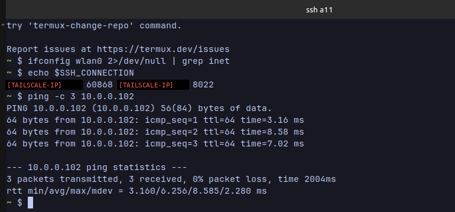

---

## Fase 2 — Inventário automático da rede

### Script final (`~/inventario.sh`)

```bash
#!/data/data/com.termux/files/usr/bin/bash
export PATH=/data/data/com.termux/files/usr/bin:/system/bin:$PATH
BASE="10.0.0"
DIR="$HOME/inventario"
mkdir -p "$DIR"
AGORA=$(date +%Y%m%d-%H%M)
TMP="$DIR/.tmp-$AGORA"

# Método 1: ping sweep em paralelo (ICMP funciona sem root no Android)
for i in $(seq 1 254); do
  ping -c1 -W1 "$BASE.$i" >/dev/null 2>&1 && echo "$BASE.$i" >> "$TMP" &
done
wait

# Método 2: nmap testando portas comuns (TCP connect, sem root)
nmap -sn -PS22,80,443,445,554,3389,8080,8443,62078 "$BASE.0/24" -oG - \
  | awk '/Up$/{print $2}' >> "$TMP"

sort -u -t. -k4,4n "$TMP" > "$DIR/hosts-$AGORA.txt"
rm -f "$TMP"

# Compara com a varredura anterior e alerta sobre hosts NOVOS
ANTERIOR=$(ls -t "$DIR"/hosts-*.txt | sed -n 2p)
if [ -n "$ANTERIOR" ]; then
  NOVOS=$(comm -13 <(sort "$ANTERIOR") <(sort "$DIR/hosts-$AGORA.txt"))
  [ -n "$NOVOS" ] && echo "$AGORA NOVO(S): $(echo $NOVOS)" >> "$DIR/alertas.log"
fi

# Retenção: apaga inventários com mais de 7 dias
find "$DIR" -name "hosts-*.txt" -mtime +7 -delete
```

Com os dois métodos combinados, a varredura passou de **3 para 5 hosts** detectados:

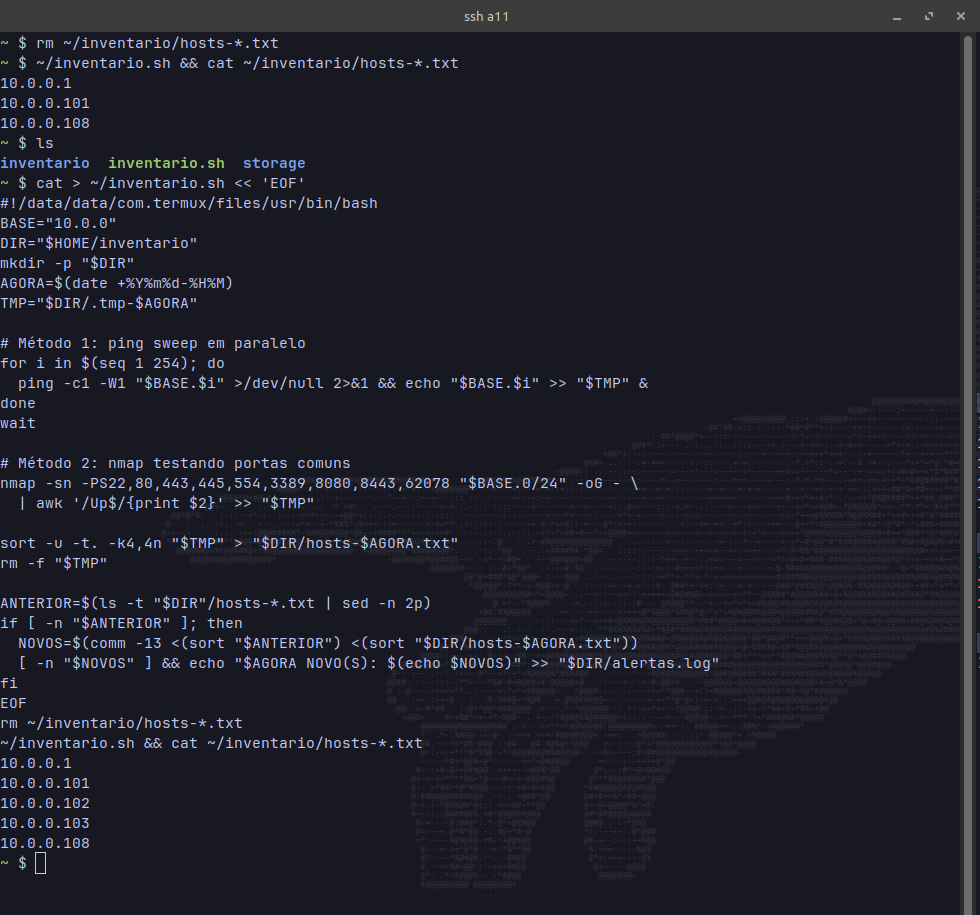

### Agendamento

```bash
sv-enable crond
sv-enable sshd       # SSH sobe sozinho quando o Termux abre
(crontab -l 2>/dev/null; echo "*/15 * * * * ~/inventario.sh") | crontab -
```

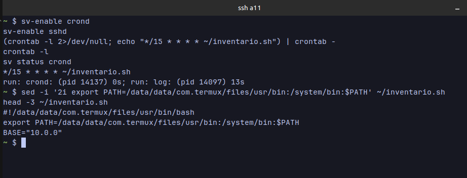

Validação: o cron gerou o arquivo das 16:45 sozinho.

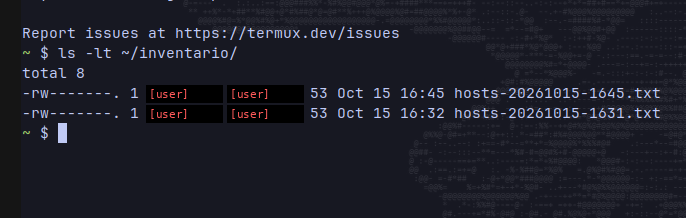

### Inventário de ativos

Cruzando com uma varredura com root no Mint (que lê a camada 2):

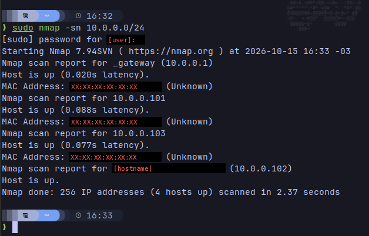

| IP | Tipo de MAC | Identificação |
|---|---|---|
| 10.0.0.1 | Real (de fábrica) | Roteador / gateway |
| 10.0.0.101 | **Aleatório** | Celular/tablet |
| 10.0.0.102 | — | Notebook Mint |
| 10.0.0.103 | **Aleatório** | Celular/tablet |
| 10.0.0.108 | **Aleatório** | Galaxy A11 (sensor) |

> **Como identificar um MAC aleatório:** se o 2º caractere for `2`, `6`, `A` ou `E`, o bit "administrado localmente" está ligado. Celulares modernos usam isso por privacidade, então não dá para descobrir o fabricante pelo OUI.

---

## Fase 3 — Captura e análise de tráfego

### Captura com PCAPdroid

O PCAPdroid captura o tráfego do próprio celular **sem root**, usando a API de VPN do Android, e salva em `.pcap`.

Primeira tentativa falhou: o Tailscale estava como **VPN sempre ativa** e o Android só permite uma VPN por vez.

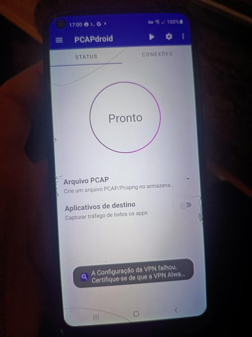

Depois de desativar o Always-on temporariamente (e manter o acesso pelo `a11-lan`), a captura funcionou: **37,9 MB em ~4 minutos** de uso normal + 2 minutos de celular parado.

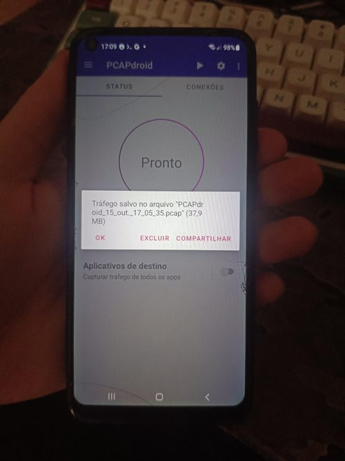

```bash
# Arquivo fica em Download/PCAPdroid/
scp 'a11-lan:/storage/emulated/0/Download/PCAPdroid/<arquivo>.pcap' ~/captura-a11.pcap
```

### Análise com tshark

**Domínios acessados (SNI do TLS ClientHello):**

```bash
tshark -r ~/captura-a11.pcap -Y "tls.handshake.type==1" \
  -T fields -e tls.handshake.extensions_server_name | LC_ALL=C sort | uniq -c | LC_ALL=C sort -rn | head -40
```

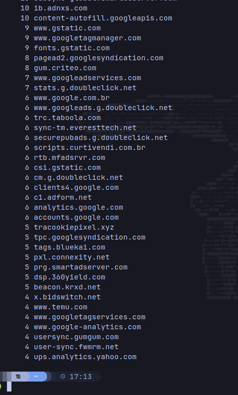

**Consultas DNS:**

```bash
tshark -r ~/captura-a11.pcap -Y "dns.flags.response==0" \
  -T fields -e dns.qry.name | LC_ALL=C sort | uniq -c | LC_ALL=C sort -rn | head -40
```

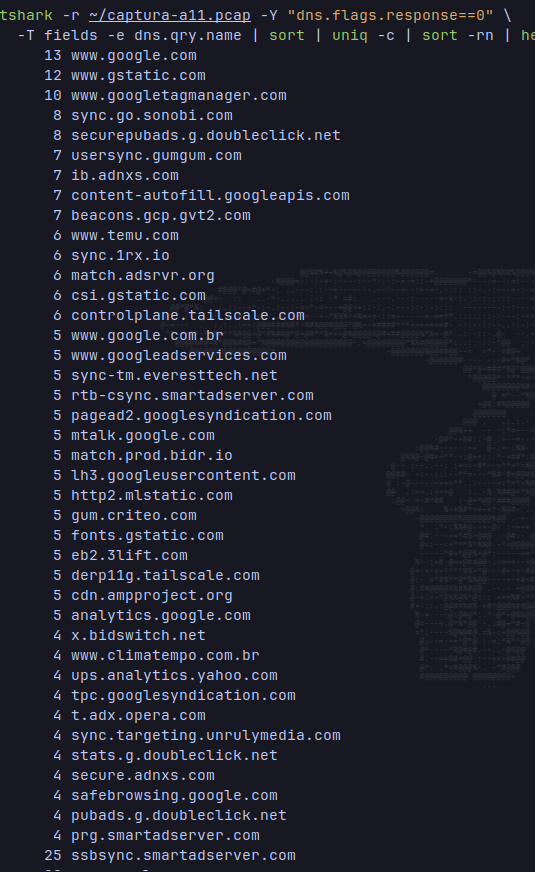

### Resultados

| Categoria | Exemplos | Observação |
|---|---|---|
| **Publicidade / rastreamento** (maioria) | doubleclick, googlesyndication, criteo, taboola, adnxs, bidswitch, smartadserver, gumgum, bluekai | Muitos com `sync`/`usersync`/`match`: **cookie syncing** entre empresas de anúncio para leilão em tempo real (RTB) |
| **Serviços do sistema** | `mtalk.google.com` (push FCM), `safebrowsing.google.com`, `beacons.gcp.gvt2.com` | Ruído de fundo esperado |
| **Tailscale tentando reconectar** | `controlplane.tailscale.com`, `derp11g.tailscale.com` | Confirma o conflito de VPN na prática |
| **Uso do usuário** | climatempo.com.br, mlstatic.com, temu.com | Tráfego legítimo |
| **Indicador investigado** | `tracookiepixel.xyz` | Ver investigação abaixo: rastreamento, sem evidência de malware |

> Abrir **um único site** fez o celular contatar **mais de 30 domínios de terceiros**.

### 🔍 Investigação de indicador: `tracookiepixel.xyz`

**Por que chamou atenção:** TLD `.xyz` (muito usado em domínios descartáveis) e nome genérico, sem marca de empresa conhecida, no meio do tráfego de anúncios.

**Fontes consultadas:**

| Fonte | Resultado |
|---|---|
| **VirusTotal** | **0/93** motores como malicioso; 1 (LevelBlue) como *suspicious*. Categorias: Information Technology / video hosting. Resposta do tipo `application/json`. Primeira submissão em 2025-05 |
| **Joe Sandbox** (comentários da comunidade no VT) | Veredito *SUS*, score **20/100**, aparecendo junto de domínios comuns do Google nas análises |
| **URLhaus** | Consulta pendente (busca pelo domínio no banco de URLs de malware) |

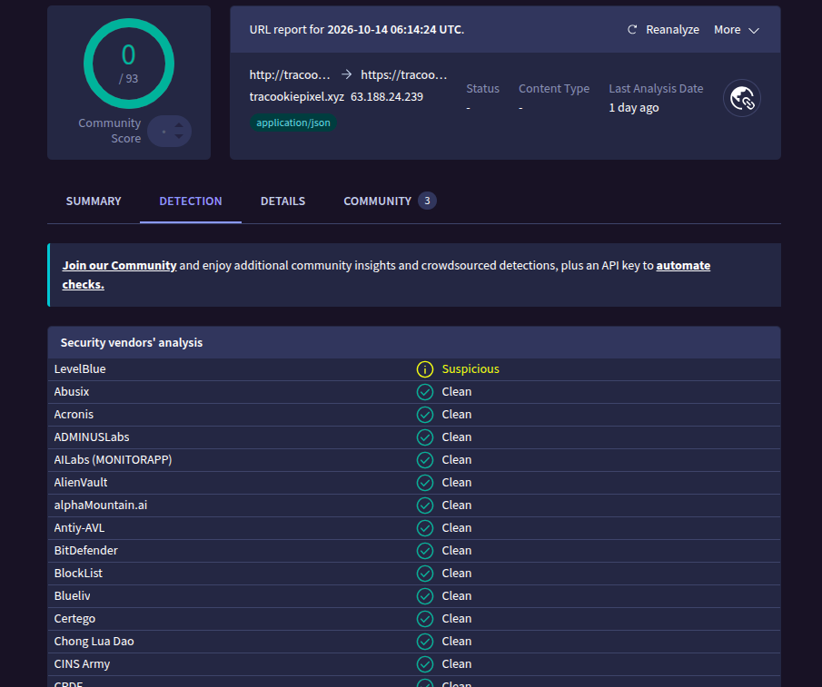

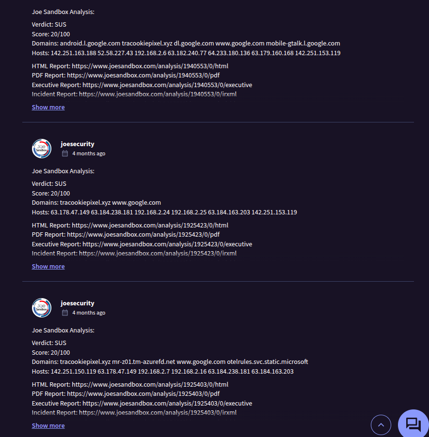

**Análise:**
- Nenhum motor classifica o domínio como malicioso; o único alerta é de baixa confiança.
- Score 20/100 no sandbox indica comportamento "curioso", não um payload perigoso.
- O próprio nome ("tracking cookie pixel"), a resposta em JSON e o fato de aparecer no meio de dezenas de domínios de cookie sync apontam para um **pixel de rastreamento de ad-tech**.

**Conclusão:** 🟡 **Baixo risco — rastreamento/publicidade, sem evidência de malware.** Não exige resposta a incidente, mas é um bom candidato a bloqueio por DNS (Pi-hole/AdGuard Home), já que não traz nenhuma função útil ao usuário.

> Fluxo usado: **detecção na captura → enriquecimento em fontes de threat intel → correlação com o contexto → veredito documentado.**

---

## 🔧 Problemas encontrados e soluções

| # | Problema | Causa | Solução |
|---|---|---|---|
| 1 | `ifconfig` não retornava nada | `net-tools` não vem no Termux e o erro estava escondido por `2>/dev/null` | Usei `$SSH_CONNECTION` e `ip route` no Mint |
| 2 | IPs `100.x.x.x` em vez da LAN | O SSH passava pelo **Tailscale** (faixa CGNAT 100.64.0.0/10) | Identifiquei a LAN real (`10.0.0.0/24`) pelo Mint e validei com ping |
| 3 | `nmap: command not found` | Pacote não foi instalado na primeira vez | `pkg install nmap` + apagar a linha de base vazia (senão todos os hosts virariam "novos") |
| 4 | O Mint não aparecia na varredura | Sem root, `nmap -sn` não usa ICMP, só TCP 80/443 | Combinei **ping sweep** + nmap com mais portas (`-PS`) |
| 5 | O A11 sumiu da varredura feita pelo Mint | Wi-Fi do Android em economia de energia | Documentado como **falso negativo**; o script só alerta sobre hosts *novos*, nunca sobre os que somem |
| 6 | `sv-enable`/`crontab` não encontrados | `termux-services` exige reiniciar o Termux | Instalar, reiniciar o app, habilitar `crond` e `sshd` |
| 7 | Risco de o cron não achar os binários | PATH mínimo no cron | `export PATH=...` no topo do script |
| 8 | PCAPdroid: "A configuração da VPN falhou" | Tailscale como **Always-on VPN** | Desativei temporariamente e usei o acesso `a11-lan` |
| 9 | Config SSH gravada no lugar errado | Comando rodado na sessão do celular, não no Mint | Atenção ao prompt (`~ $` = Termux; `❯` = Mint) |
| 10 | `find` não achava o `.pcap` | `~/storage/shared` é **link simbólico** | Buscar direto em `/storage/emulated/0` |
| 11 | Ordenação estranha no `sort` | Locale pt_BR | `LC_ALL=C sort` |

---

## Aprendizados

- **Uma ferramenta só vê o que o método dela permite ver.** Sem root, o nmap ficou cego para hosts sem portas abertas; combinar métodos aumentou a cobertura.
- **MAC aleatório limita a identificação por fabricante.** Em redes modernas, o inventário precisa de outras fontes (lista DHCP do roteador, hostname).
- **Host que some ≠ host que saiu.** Dispositivos em economia de energia geram falsos negativos; a lógica de alerta precisa considerar isso.
- **Segurança vs. visibilidade:** o Always-on VPN protege o tráfego, mas bloqueia ferramentas legítimas de análise.
- **Túnel de gerência ≠ rede monitorada:** o Tailscale dá acesso remoto sem abrir portas, mas a varredura acontece pela LAN.
- **O ecossistema de ad-tech é enorme:** a maior parte do tráfego de navegação é rastreamento, não o conteúdo que o usuário pediu.

---

## Próximos passos

- [ ] Identificar todos os hosts pela lista de clientes DHCP do roteador
- [ ] Enviar os alertas para o celular/Mint (notificação ou webhook)
- [ ] Subir **Pi-hole / AdGuard Home** e medir o antes/depois com a mesma captura
- [ ] Integrar o sensor ao **Zabbix** do homelab
- [ ] Migrar o sensor para o homelab com ThinkCentre Tiny

---

> 🔒 **Privacidade:** endereços MAC, IPs do Tailscale, usuário do Termux e hostname foram ocultados nos prints. Os IPs `10.0.0.x` são de rede privada e não são roteáveis pela internet.
