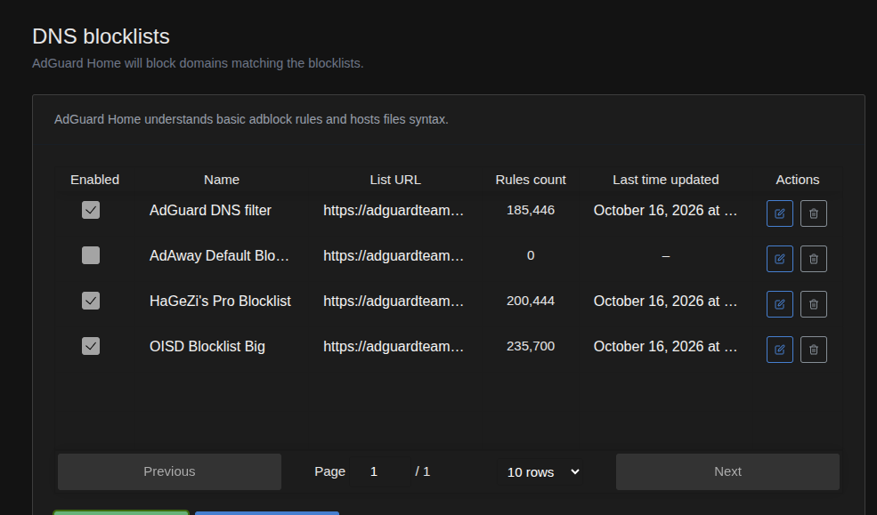
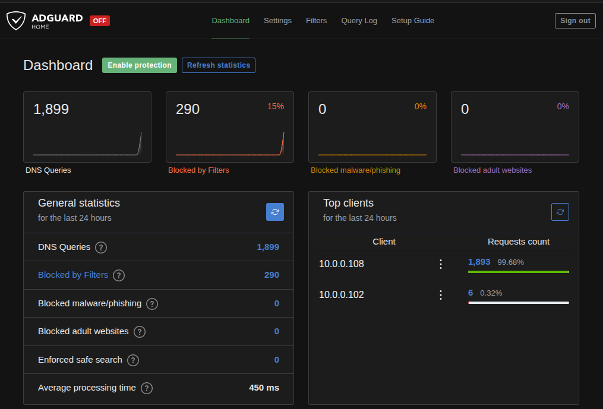
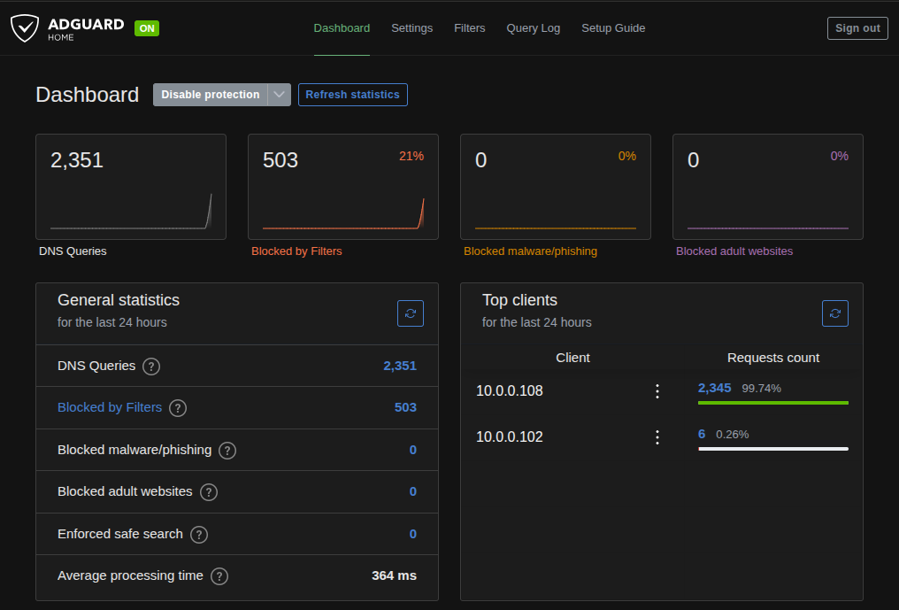
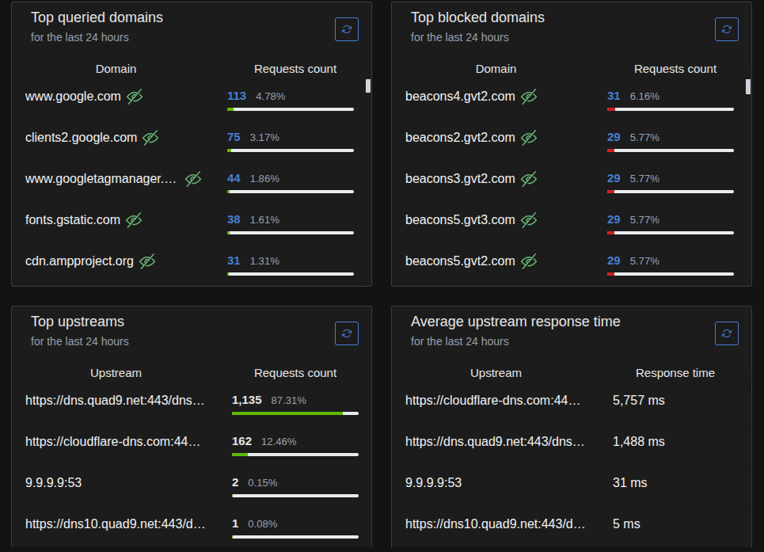
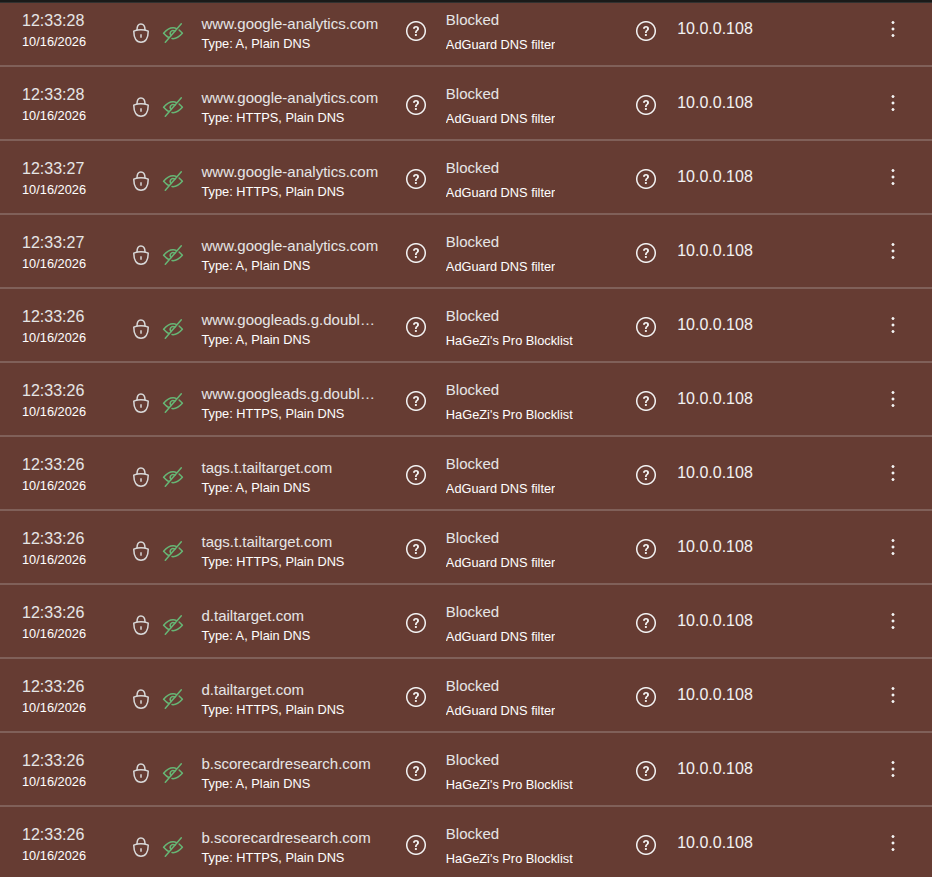
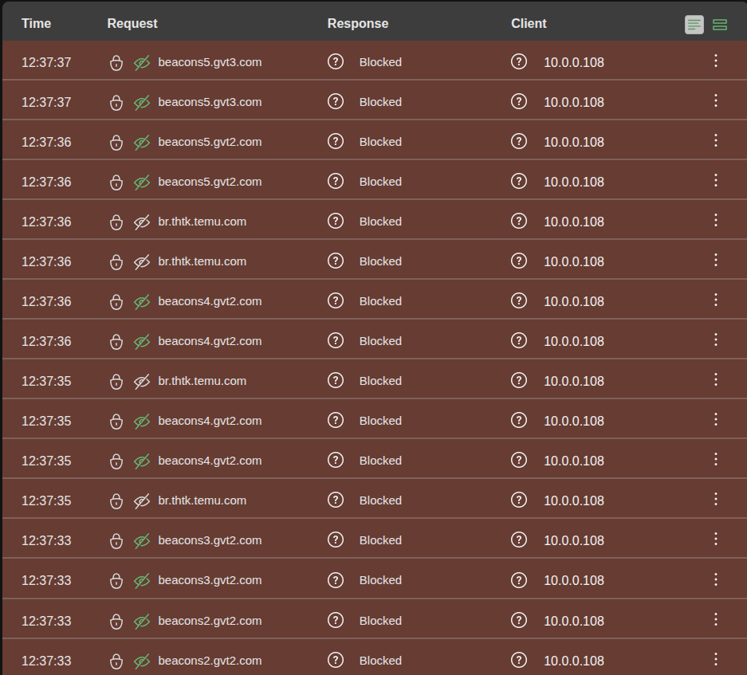

# Lab: Celular Android como sensor de rede (sem root)

Transformei um **Samsung Galaxy A11** parado em casa num **sensor de monitoramento de rede** para o meu homelab. Ele faz inventário automático da rede doméstica, alerta quando aparece um dispositivo novo e captura tráfego para análise no Wireshark/tshark. Tudo **sem root e sem formatar o aparelho**.

> Lab feito como prática de **Blue Team**: inventário de ativos, detecção de anomalias e análise de tráfego, enfrentando as limitações reais do ambiente.

---

## Sumário

- [Arquitetura](#-arquitetura)
- [Ferramentas](#-ferramentas)
- [Fase 1 — Base: Termux + SSH](#fase-1--base-termux--ssh)
- [Fase 2 — Inventário automático da rede](#fase-2--inventário-automático-da-rede)
- [Fase 3 — Captura e análise de tráfego](#fase-3--captura-e-análise-de-tráfego)
- [Fase 4 — Bloqueio de rastreadores por DNS (AdGuard Home)](#fase-4--bloqueio-de-rastreadores-por-dns-adguard-home)
- [Problemas encontrados e soluções](#-problemas-encontrados-e-soluções)
- [Aprendizados](#-aprendizados)
- [Próximos passos](#-próximos-passos)

---

## Arquitetura

```
                 Internet
                    │
            ┌───────┴───────┐
            │  Roteador     │  10.0.0.1
            │  10.0.0.0/24  │
            └───┬───────┬───┘
                │ Wi-Fi │
   ┌────────────┴──┐ ┌──┴──────────────────────┐
   │ Notebook Mint │ │ Galaxy A11 (sensor)     │
   │ 10.0.0.102    │ │ 10.0.0.108              │
   │ - SSH client  │ │ - Termux + sshd :8022   │
   │ - tshark      │ │ - nmap + ping sweep     │
   │ - Wireshark   │ │ - cron a cada 15 min    │
   │ - AdGuard :53 │ │ - PCAPdroid             │
   └───────┬───────┘ │ - DNS → 10.0.0.102      │
           │         └──────────┬──────────────┘
           └── Tailscale (acesso remoto, sem abrir portas) ──┘
```

| Componente | Função |
|---|---|
| **Galaxy A11** (Android, sem root) | Sensor: varre a rede e captura tráfego |
| **Notebook Linux Mint** | Estação de análise e gerência via SSH; servidor DNS com **AdGuard Home** (Docker) |
| **Tailscale** | Acesso remoto ao sensor de qualquer lugar, sem port forwarding |

---

## Ferramentas

`Termux` · `OpenSSH` · `nmap` · `ping` · `cronie` + `termux-services` · `PCAPdroid` · `tshark` / `Wireshark` · `Tailscale` · `Docker` · `AdGuard Home`

---

## Fase 1 — Base: Termux + SSH

Termux instalado pelo **F-Droid** (a versão da Play Store está desatualizada) e removido da otimização de bateria do Android.

```bash
# No A11 (Termux)
pkg update && pkg upgrade -y
pkg install openssh nmap termux-services cronie -y
passwd
sshd                 # SSH na porta 8022
termux-wake-lock     # impede o Android de suspender o Termux
```

```bash
# No Mint: chave SSH em vez de senha
ssh-keygen -t ed25519
ssh-copy-id a11
```

`~/.ssh/config` no Mint, com dois caminhos de acesso:

```
Host a11
    HostName <IP-TAILSCALE-DO-A11>
    Port 8022
    User <usuario-termux>

Host a11-lan
    HostName 10.0.0.108
    Port 8022
    User <usuario-termux>
```

- `a11`: via Tailscale, funciona de fora de casa.
- `a11-lan`: via rede local, plano B quando o Tailscale está desligado.

Confirmação de que o sensor enxerga a LAN (TTL 64 = mesmo segmento, sem roteador no meio):


---

## Fase 2 — Inventário automático da rede

### Script final (`~/inventario.sh`)

```bash
#!/data/data/com.termux/files/usr/bin/bash
export PATH=/data/data/com.termux/files/usr/bin:/system/bin:$PATH
BASE="10.0.0"
DIR="$HOME/inventario"
mkdir -p "$DIR"
AGORA=$(date +%Y%m%d-%H%M)
TMP="$DIR/.tmp-$AGORA"

# Método 1: ping sweep em paralelo (ICMP funciona sem root no Android)
for i in $(seq 1 254); do
  ping -c1 -W1 "$BASE.$i" >/dev/null 2>&1 && echo "$BASE.$i" >> "$TMP" &
done
wait

# Método 2: nmap testando portas comuns (TCP connect, sem root)
nmap -sn -PS22,80,443,445,554,3389,8080,8443,62078 "$BASE.0/24" -oG - \
  | awk '/Up$/{print $2}' >> "$TMP"

sort -u -t. -k4,4n "$TMP" > "$DIR/hosts-$AGORA.txt"
rm -f "$TMP"

# Compara com a varredura anterior e alerta sobre hosts NOVOS
ANTERIOR=$(ls -t "$DIR"/hosts-*.txt | sed -n 2p)
if [ -n "$ANTERIOR" ]; then
  NOVOS=$(comm -13 <(sort "$ANTERIOR") <(sort "$DIR/hosts-$AGORA.txt"))
  [ -n "$NOVOS" ] && echo "$AGORA NOVO(S): $(echo $NOVOS)" >> "$DIR/alertas.log"
fi

# Retenção: apaga inventários com mais de 7 dias
find "$DIR" -name "hosts-*.txt" -mtime +7 -delete
```

Com os dois métodos combinados, a varredura passou de **3 para 5 hosts** detectados:


### Agendamento

```bash
sv-enable crond
sv-enable sshd       # SSH sobe sozinho quando o Termux abre
(crontab -l 2>/dev/null; echo "*/15 * * * * ~/inventario.sh") | crontab -
```


Validação: o cron gerou o arquivo das 16:45 sozinho.


### Inventário de ativos

Cruzando com uma varredura com root no Mint (que lê a camada 2):


| IP | Tipo de MAC | Identificação |
|---|---|---|
| 10.0.0.1 | Real (de fábrica) | Roteador / gateway |
| 10.0.0.101 | **Aleatório** | Celular/tablet |
| 10.0.0.102 | — | Notebook Mint |
| 10.0.0.103 | **Aleatório** | Celular/tablet |
| 10.0.0.108 | **Aleatório** | Galaxy A11 (sensor) |

> **Como identificar um MAC aleatório:** se o 2º caractere for `2`, `6`, `A` ou `E`, o bit "administrado localmente" está ligado. Celulares modernos usam isso por privacidade, então não dá para descobrir o fabricante pelo OUI.

---

## Fase 3 — Captura e análise de tráfego

### Captura com PCAPdroid

O PCAPdroid captura o tráfego do próprio celular **sem root**, usando a API de VPN do Android, e salva em `.pcap`.

Primeira tentativa falhou: o Tailscale estava como **VPN sempre ativa** e o Android só permite uma VPN por vez.


Depois de desativar o Always-on temporariamente (e manter o acesso pelo `a11-lan`), a captura funcionou: **37,9 MB em ~4 minutos** de uso normal + 2 minutos de celular parado.


```bash
# Arquivo fica em Download/PCAPdroid/
scp 'a11-lan:/storage/emulated/0/Download/PCAPdroid/<arquivo>.pcap' ~/captura-a11.pcap
```

### Análise com tshark

**Domínios acessados (SNI do TLS ClientHello):**

```bash
tshark -r ~/captura-a11.pcap -Y "tls.handshake.type==1" \
  -T fields -e tls.handshake.extensions_server_name | LC_ALL=C sort | uniq -c | LC_ALL=C sort -rn | head -40
```


**Consultas DNS:**

```bash
tshark -r ~/captura-a11.pcap -Y "dns.flags.response==0" \
  -T fields -e dns.qry.name | LC_ALL=C sort | uniq -c | LC_ALL=C sort -rn | head -40
```


### Resultados

| Categoria | Exemplos | Observação |
|---|---|---|
| **Publicidade / rastreamento** (maioria) | doubleclick, googlesyndication, criteo, taboola, adnxs, bidswitch, smartadserver, gumgum, bluekai | Muitos com `sync`/`usersync`/`match`: **cookie syncing** entre empresas de anúncio para leilão em tempo real (RTB) |
| **Serviços do sistema** | `mtalk.google.com` (push FCM), `safebrowsing.google.com`, `beacons.gcp.gvt2.com` | Ruído de fundo esperado |
| **Tailscale tentando reconectar** | `controlplane.tailscale.com`, `derp11g.tailscale.com` | Confirma o conflito de VPN na prática |
| **Uso do usuário** | climatempo.com.br, mlstatic.com, temu.com | Tráfego legítimo |
| **Indicador investigado** | `tracookiepixel.xyz` | Ver investigação abaixo: rastreamento, sem evidência de malware |

> Abrir **um único site** fez o celular contatar **mais de 30 domínios de terceiros**.

### 🔍 Investigação de indicador: `tracookiepixel.xyz`

**Por que chamou atenção:** TLD `.xyz` (muito usado em domínios descartáveis) e nome genérico, sem marca de empresa conhecida, no meio do tráfego de anúncios.

**Fontes consultadas:**

| Fonte | Resultado |
|---|---|
| **VirusTotal** | **0/93** motores como malicioso; 1 (LevelBlue) como *suspicious*. Categorias: Information Technology / video hosting. Resposta do tipo `application/json`. Primeira submissão em 2025-05 |
| **Joe Sandbox** (comentários da comunidade no VT) | Veredito *SUS*, score **20/100**, aparecendo junto de domínios comuns do Google nas análises |
| **URLhaus** | Consulta pendente (busca pelo domínio no banco de URLs de malware) |


**Análise:**
- Nenhum motor classifica o domínio como malicioso; o único alerta é de baixa confiança.
- Score 20/100 no sandbox indica comportamento "curioso", não um payload perigoso.
- O próprio nome ("tracking cookie pixel"), a resposta em JSON e o fato de aparecer no meio de dezenas de domínios de cookie sync apontam para um **pixel de rastreamento de ad-tech**.

**Conclusão:** 🟡 **Baixo risco — rastreamento/publicidade, sem evidência de malware.** Não exige resposta a incidente, mas é um bom candidato a bloqueio por DNS (Pi-hole/AdGuard Home), já que não traz nenhuma função útil ao usuário.

> Fluxo usado: **detecção na captura → enriquecimento em fontes de threat intel → correlação com o contexto → veredito documentado.**

---

## Fase 4 — Bloqueio de rastreadores por DNS (AdGuard Home)

A Fase 3 mostrou que a maior parte do tráfego de navegação do A11 era publicidade e rastreamento. Nesta fase subi um **filtro de DNS** na rede e medi o efeito com o mesmo método de captura: **antes × depois**.

### Por que o filtro não roda no próprio A11

A primeira ideia foi instalar o Pi-hole ou o AdGuard Home no celular. Sem root, não funciona:

| Opção no A11 | Problema |
|---|---|
| Pi-hole no Termux / `proot-distro` | Precisa de um Linux completo e de escutar na **porta 53**. Portas abaixo de 1024 exigem root |
| AdGuard Home no Termux | O binário roda, mas só numa porta alta (ex.: 5353). O DNS do Wi-Fi do Android e o DHCP do roteador só aceitam a porta 53 |
| Apps de bloqueio "sem root" (AdGuard, RethinkDNS) | Usam a API de VPN do Android, a mesma do PCAPdroid. **Só uma VPN por vez** (mesmo conflito do Tailscale na Fase 3) |

**Decisão:** AdGuard Home em **Docker no notebook Mint**. O A11 continua como sensor e passa a ser cliente do DNS filtrado. Escolhi o AdGuard Home em vez do Pi-hole por ser um container só, ter query log por cliente e suportar DoH/DoT nativamente. O mesmo `docker-compose.yml` serve para migrar para o ThinkCentre depois.

### Instalação no Mint

```yaml
# ~/homelab/adguard/docker-compose.yml  (fora do repositório: conf/ guarda o hash da senha do painel)
services:
  adguardhome:
    image: adguard/adguardhome:latest
    container_name: adguardhome
    restart: unless-stopped
    ports:
      - "10.0.0.102:53:53/udp"
      - "10.0.0.102:53:53/tcp"
      - "10.0.0.102:3000:3000/tcp"   # assistente de instalação (só na 1ª vez)
      - "10.0.0.102:8080:80/tcp"     # painel web
    volumes:
      - ./work:/opt/adguardhome/work
      - ./conf:/opt/adguardhome/conf
```

```bash
docker compose up -d
```

> As portas ficam presas ao IP da LAN (`10.0.0.102`) de propósito: a porta 53 do `127.0.0.53` já é do `systemd-resolved` do Mint, e publicar em `0.0.0.0:53` daria conflito.

**Configuração no painel:**

| Item | Valor |
|---|---|
| Upstreams | `https://dns.quad9.net/dns-query` e `https://cloudflare-dns.com/dns-query` (DNS-over-HTTPS, em paralelo) |
| Fallback | `9.9.9.9` e `1.1.1.1` |
| Listas de bloqueio | AdGuard DNS filter, HaGeZi's Pro, OISD Big (~621 mil regras somadas, com sobreposição) |



Teste a partir do Mint, antes de mexer no celular:

```bash
dig @10.0.0.102 climatempo.com.br +short   # IP real → resolve normalmente
dig @10.0.0.102 doubleclick.net +short     # 0.0.0.0 → bloqueado
```

### Apontando o A11 para o filtro

1. **DNS privado → Desativado.** No modo "Automático", o Android pode usar DNS-over-TLS direto com o Google e ignorar o DNS da rede.
2. **Tailscale desligado**, por dois motivos: o MagicDNS (`100.100.100.100`) também desvia o DNS, e a VPN conflita com o PCAPdroid.
3. **Wi-Fi com IP estático:** IP `10.0.0.108`, gateway `10.0.0.1`, **DNS 1 e DNS 2 = `10.0.0.102`**. Usar o roteador como DNS 2 deixaria o Android contornar o filtro.
4. **Validação:** o painel passou a mostrar consultas do cliente `10.0.0.108`, inclusive com o PCAPdroid ligado. Isso confirma que o PCAPdroid repassa o DNS para o sistema e que a captura mede o caminho filtrado.

### Metodologia da comparação

A captura da Fase 3 foi uso livre e não servia de base. Fiz **duas capturas novas com o mesmo roteiro**:

- Chrome com o cache limpo e as abas fechadas.
- climatempo.com.br, mercadolivre.com.br e temu.com, ~1 min rolando cada um.
- Celular parado com a tela ligada até o fim.

| | Captura A | Captura B |
|---|---|---|
| AdGuard | Proteção **desligada** (só repassa) | Proteção **ligada** |
| Duração | 5,5 min | 8,1 min |

> Nas duas capturas o DNS passa pelo AdGuard. A única variável é o filtro ligado ou desligado.

Como o painel não zerou as estatísticas, anotei o placar no início e no fim de cada captura e usei a diferença.





Métricas extraídas com tshark:

```bash
m(){ f=$1; echo "== $f"
  echo "SNI unicos: $(tshark -r "$f" -Y 'tls.handshake.type==1' -T fields -e tls.handshake.extensions_server_name | sort -u | grep -c .)"
  echo "Conexoes TLS: $(tshark -r "$f" -Y 'tls.handshake.type==1' | wc -l)"
  echo "IPs de destino: $(tshark -r "$f" -T fields -e ip.dst | sort -u | grep -c .)"
  echo "Consultas DNS: $(tshark -r "$f" -Y 'dns.flags.response==0' | wc -l)"
  echo "Respostas 0.0.0.0: $(tshark -r "$f" -Y 'dns.a==0.0.0.0' | wc -l)"; }
m antes.pcap; m depois.pcap
```

### Resultados

| Métrica | Antes (OFF) | Depois (ON) | Variação |
|---|---|---|---|
| **Domínios contatados** (SNI únicos) | 246 | 39 | **−84%** |
| Conexões TLS | 497 | 111 | −78% |
| **IPs de destino únicos** | 493 | 53 | **−89%** |
| Consultas DNS (pcap) | 912 | 493 | −46% |
| Respostas bloqueadas (`0.0.0.0`) | 0 | 101 (54 nomes únicos) | — |
| Tráfego total | 18 MB | 8,7 MB | −52% |
| Placar do AdGuard (diferença) | 734 consultas / 0 bloqueadas | 452 consultas / **213 bloqueadas (47%)** | — |

> A captura B foi **47% mais longa** e mesmo assim teve muito menos conexões. A redução real é, no mínimo, essa.

Comparando as listas de domínios das duas capturas:

```bash
for f in antes depois; do
  tshark -r $f.pcap -Y 'tls.handshake.type==1' -T fields -e tls.handshake.extensions_server_name | LC_ALL=C sort -u > $f-sni.txt
done
LC_ALL=C comm -23 antes-sni.txt depois-sni.txt   # domínios que sumiram com o filtro
```

- **212 domínios sumiram**, e pelo menos **119** deles têm nome claro de anúncio ou rastreamento (`*.doubleclick.net`, `*.googlesyndication.com`, `*.taboola.com`, `criteo`, `adnxs`, `beacons*.gvt2.com`).
- **Os três sites do roteiro continuaram funcionando**: climatempo, mercadolivre (com as APIs) e temu aparecem nas duas capturas.



### O que o query log mostrou



- **As três listas se complementam.** A AdGuard DNS filter pegou google-analytics, googlesyndication e tailtarget. A HaGeZi Pro pegou doubleclick e scorecardresearch. A OISD Big pegou adnxs e analytics.google.com. Nenhuma sozinha cobriria tudo.
- **Cada domínio aparece duas vezes**, como `A` e como `HTTPS`. O Chrome pede junto o registro HTTPS/SVCB (suporte a HTTP/3 e ECH), o que dobra a contagem de consultas bloqueadas.



- **O maior rastreador foi o próprio navegador.** Os `beacons*.gvt2.com` / `gvt3.com` (telemetria do Chrome/Google) lideram os bloqueios, e o Chrome tenta de novo várias vezes ao receber `0.0.0.0`. Essas repetições inflam o "% bloqueado" do painel. Por isso usei domínios únicos do pcap como métrica principal.
- **Rastreamento first-party:** `br.thtk.temu.com` é rastreamento num subdomínio do próprio site, técnica usada para escapar de bloqueadores. Ele aparece com o ícone branco (fora do banco de rastreadores conhecidos do AdGuard), mas foi pego pela lista.

### Limitações encontradas

| Limitação | Evidência |
|---|---|
| **Listas não bloqueiam tudo** | `www.googletagmanager.com`, `www.googleadservices.com`, `www.googletagservices.com` e `cdn.taboola.com` passaram com a proteção ligada. O `dig` no AdGuard devolve IP real: as listas deixam esses domínios passar porque bloqueá-los quebra checkout e medição de conversão em muitos sites |
| **Bloqueio por DNS é por domínio inteiro** | Não separa um script útil de um rastreador hospedado no mesmo domínio. Para isso é preciso filtro no navegador (ex.: uBlock Origin) |
| **DNS do navegador pode contornar o filtro** | Se o "Usar DNS seguro" do Chrome estiver apontado para Google/Cloudflare, o navegador ignora o DNS da rede |
| **Ponto único de falha** | Às 12:21, o Mint perdeu a internet por ~1 min: Quad9, Cloudflare e até o bootstrap deram timeout ao mesmo tempo. O A11 ficou sem DNS nesse período. O fallback `9.9.9.9` chegou a ser usado, e o tempo médio de resposta do painel ficou inflado por esses timeouts |
| **Roteiro manual** | Apps em segundo plano e um site fora do roteiro aparecem só em uma das capturas. O efeito é pequeno perto da redução medida, mas existe |

**Conclusão:** um filtro de DNS na rede, sem nada instalado no celular, cortou **84% dos domínios** e **89% dos destinos** contatados numa navegação comum, sem quebrar os sites usados. É uma camada barata e eficaz, mas não é completa: ela não substitui um bloqueador no navegador e cria uma dependência (se o servidor DNS cair, a rede fica sem resolução de nomes).

---

## 🔧 Problemas encontrados e soluções

| # | Problema | Causa | Solução |
|---|---|---|---|
| 1 | `ifconfig` não retornava nada | `net-tools` não vem no Termux e o erro estava escondido por `2>/dev/null` | Usei `$SSH_CONNECTION` e `ip route` no Mint |
| 2 | IPs `100.x.x.x` em vez da LAN | O SSH passava pelo **Tailscale** (faixa CGNAT 100.64.0.0/10) | Identifiquei a LAN real (`10.0.0.0/24`) pelo Mint e validei com ping |
| 3 | `nmap: command not found` | Pacote não foi instalado na primeira vez | `pkg install nmap` + apagar a linha de base vazia (senão todos os hosts virariam "novos") |
| 4 | O Mint não aparecia na varredura | Sem root, `nmap -sn` não usa ICMP, só TCP 80/443 | Combinei **ping sweep** + nmap com mais portas (`-PS`) |
| 5 | O A11 sumiu da varredura feita pelo Mint | Wi-Fi do Android em economia de energia | Documentado como **falso negativo**; o script só alerta sobre hosts *novos*, nunca sobre os que somem |
| 6 | `sv-enable`/`crontab` não encontrados | `termux-services` exige reiniciar o Termux | Instalar, reiniciar o app, habilitar `crond` e `sshd` |
| 7 | Risco de o cron não achar os binários | PATH mínimo no cron | `export PATH=...` no topo do script |
| 8 | PCAPdroid: "A configuração da VPN falhou" | Tailscale como **Always-on VPN** | Desativei temporariamente e usei o acesso `a11-lan` |
| 9 | Config SSH gravada no lugar errado | Comando rodado na sessão do celular, não no Mint | Atenção ao prompt (`~ $` = Termux; `❯` = Mint) |
| 10 | `find` não achava o `.pcap` | `~/storage/shared` é **link simbólico** | Buscar direto em `/storage/emulated/0` |
| 11 | Ordenação estranha no `sort` | Locale pt_BR | `LC_ALL=C sort` |
| 12 | Pi-hole/AdGuard Home não servem como DNS rodando no A11 | Sem root, o Android não deixa escutar na porta 53 | Servidor DNS no Mint (Docker); o A11 virou cliente |
| 13 | YAML colado direto no terminal virou "command not found" | O shell tentou executar cada linha do arquivo | Criar o arquivo com heredoc (`cat > arquivo <<'EOF'`) ou editor |
| 14 | Painel do AdGuard não abriu após o assistente | O assistente redireciona para a porta 80 interna, publicada como 8080 | Acessar `http://10.0.0.102:8080` |
| 15 | `dig` no Termux mostrava `8.8.8.8` | O Termux usa o próprio `resolv.conf`, não o DNS do Android | Testar com `dig @10.0.0.102` e validar pelo query log |
| 16 | Só as consultas do Termux chegavam ao AdGuard | O DNS estático do Wi-Fi ainda não tinha sido aplicado | Conferir DNS privado desativado, religar o Wi-Fi e validar com o Chrome |
| 17 | Primeira comparação inválida | Capturas de ~100 s e queda de internet do Mint no meio da captura B | Refazer as duas com roteiro fixo; conferir nos logs do container que não houve timeout de upstream |
| 18 | Estatísticas do painel não zeravam | — | Anotar o placar no início e no fim de cada captura e usar a diferença |

---

## Aprendizados

- **Uma ferramenta só vê o que o método dela permite ver.** Sem root, o nmap ficou cego para hosts sem portas abertas; combinar métodos aumentou a cobertura.
- **MAC aleatório limita a identificação por fabricante.** Em redes modernas, o inventário precisa de outras fontes (lista DHCP do roteador, hostname).
- **Host que some ≠ host que saiu.** Dispositivos em economia de energia geram falsos negativos; a lógica de alerta precisa considerar isso.
- **Segurança vs. visibilidade:** o Always-on VPN protege o tráfego, mas bloqueia ferramentas legítimas de análise.
- **Túnel de gerência ≠ rede monitorada:** o Tailscale dá acesso remoto sem abrir portas, mas a varredura acontece pela LAN.
- **O ecossistema de ad-tech é enorme:** a maior parte do tráfego de navegação é rastreamento, não o conteúdo que o usuário pediu.
- **Bloquear na rede funciona sem tocar no dispositivo:** um filtro de DNS cortou 84% dos domínios contatados, sem instalar nada no celular.
- **Comparação justa exige controlar variáveis:** o mesmo roteiro, o mesmo caminho de DNS (filtro só ligado/desligado) e conferir falhas no meio. Uma queda de internet de 1 minuto já distorceu a primeira medição.
- **Métrica certa importa:** o "% bloqueado" do painel é inflado por repetições e registros `A` + `HTTPS`; domínios e IPs únicos no pcap mostram o efeito real.
- **Controles têm pontos cegos:** listas deixam domínios passar para não quebrar sites, e DoH no navegador contorna o DNS da rede.

---

## Próximos passos

- [ ] Identificar todos os hosts pela lista de clientes DHCP do roteador
- [ ] Enviar os alertas para o celular/Mint (notificação ou webhook)
- [x] Subir **Pi-hole / AdGuard Home** e medir o antes/depois com a mesma captura (Fase 4)
- [ ] Apontar o DNS do roteador (DHCP) para o AdGuard e cobrir todos os dispositivos da rede
- [ ] Testar o "DNS privado" do Android apontando para o próprio AdGuard (DNS-over-TLS)
- [ ] Integrar o sensor ao **Zabbix** do homelab
- [ ] Migrar o sensor para o homelab com ThinkCentre Tiny

---

> 🔒 **Privacidade:** endereços MAC, IPs do Tailscale, usuário do Termux e hostname foram ocultados nos prints. Os prints do AdGuard Home não mostram usuário, senha nem hostname, e tiveram os metadados removidos. Os IPs `10.0.0.x` são de rede privada e não são roteáveis pela internet.
