# Lab 2: VLANs, Trunks e Roteamento entre VLANs

> Laboratório prático baseado no curso **Cisco Networking Academy: Network Defense**.
> Autor: **João Victor Paixão Zolim**
> Ferramenta: Cisco Packet Tracer

Segundo lab da série de 7 que constrói, passo a passo, a rede de uma pequena empresa protegida com **defesa em profundidade**. Partindo da topologia do [Lab 1](../Lab01-AcessoSeguro/), a rede é dividida em VLANs de usuários, servidores e gerência, o R1 passa a rotear entre elas, os usuários recebem IP por DHCP e a rede interna ganha saída para a internet com NAT.

**Resultado:** cada grupo de equipamentos fica no seu próprio domínio de broadcast, os PCs recebem IP automaticamente, a rede interna navega na internet com o IP público do R1, e o administrador gerencia R1, S1 e S2 por SSH a partir da VLAN de gerência.

| Item | Status |
| --- | --- |
| VLANs 10 (usuários), 20 (servidores), 99 (gerência) e 999 (nativa) em S1 e S2 | ✅ Concluído |
| Trunks 802.1Q com VLAN nativa sem uso e lista de VLANs permitidas | ✅ Concluído |
| Roteamento entre VLANs no R1 (*router-on-a-stick*) | ✅ Concluído |
| DHCP para a VLAN de usuários | ✅ Concluído |
| NAT/PAT para a internet | ✅ Concluído |
| IP de gerência em S1 e S2 (SVI da VLAN 99) | ✅ Concluído |
| Mesma senha do `netadmin` em R1, S1 e S2 (pendência do Lab 1) | ✅ Concluído |
| SSH de S1, S2 e R1 a partir do Admin-PC (pendência do Lab 1) | ✅ Concluído |
| Filtro de tráfego entre as VLANs | ✅ Concluído no [Lab 4](../Lab04-ACLs/README.md) |
| Proteção das portas de acesso | ✅ Concluído no [Lab 3](../Lab03-SegurancaSwitches/README.md) |

---

## Sumário

1. [Objetivo](#1-objetivo)
2. [Topologia](#2-topologia)
3. [Plano de VLANs e endereçamento](#3-plano-de-vlans-e-endereçamento)
4. [Como funciona](#4-como-funciona)
5. [Configuração passo a passo](#5-configuração-passo-a-passo)
6. [Verificação](#6-verificação)
7. [Problemas encontrados e soluções](#7-problemas-encontrados-e-soluções)
8. [Limitações e riscos em aberto](#8-limitações-e-riscos-em-aberto)
9. [Lições aprendidas](#9-lições-aprendidas)
10. [Próximo passo](#10-próximo-passo)

---

## 1. Objetivo

Separar a rede por **função** (usuários, servidores e gerência), para que cada grupo fique no seu próprio domínio de broadcast, e criar a base sobre a qual os próximos labs vão aplicar filtros e proteções.

Na defesa em profundidade, essa é a camada de **segmentação**: ela não bloqueia nada sozinha (o roteador ainda liga todas as VLANs), mas define as fronteiras onde os controles dos próximos labs vão atuar.

---

## 2. Topologia

| Início do lab | Fim do lab |
| --- | --- |
| 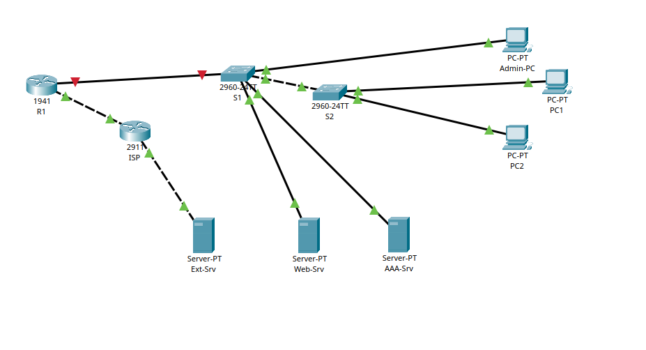 | 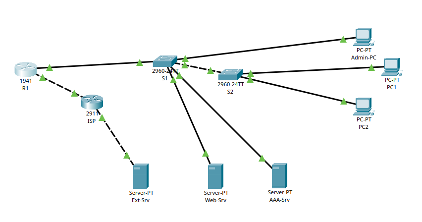 |

No início, o enlace **R1 ↔ S1 aparece vermelho** porque a G0/1 do R1 ainda estava desligada (ver Lab 1). No fim do lab, com as subinterfaces configuradas, todos os enlaces ficam verdes.

```text
                 [Ext-Srv] 198.51.100.10
                     |
                   G0/1
                  [ISP]                    ← internet simulada
                   G0/0
                     |  203.0.113.0/30
                   G0/0
                  [R1]                     ← gateway das 3 VLANs + DHCP + NAT
                   G0/1  (.10 / .20 / .99)
                     |  trunk 802.1Q (nativa 999)
                   G0/1
  [Admin-PC]──Fa0/5 [S1] Fa0/10──[Web-Srv]
    VLAN 99          |   Fa0/11──[AAA-Srv]   VLAN 20
                   G0/2
                     |  trunk 802.1Q (nativa 999)
                   G0/1
                    [S2]
              Fa0/1 /    \ Fa0/2
               [PC1]      [PC2]              VLAN 10
```

### Cabeamento

| De | Porta | Para | Porta | Cabo |
| --- | --- | --- | --- | --- |
| R1 | G0/0 | ISP | G0/0 | Copper Cross-Over |
| ISP | G0/1 | Ext-Srv | Fa0 | Copper Cross-Over |
| R1 | G0/1 | S1 | G0/1 | Copper Straight-Through |
| S1 | G0/2 | S2 | G0/1 | Copper Cross-Over |
| S1 | Fa0/5 | Admin-PC | Fa0 | Copper Straight-Through |
| S1 | Fa0/10 | Web-Srv | Fa0 | Copper Straight-Through |
| S1 | Fa0/11 | AAA-Srv | Fa0 | Copper Straight-Through |
| S2 | Fa0/1 | PC1 | Fa0 | Copper Straight-Through |
| S2 | Fa0/2 | PC2 | Fa0 | Copper Straight-Through |

**Regra:** *straight-through* entre equipamentos de tipos diferentes (roteador ↔ switch, switch ↔ host); *cross-over* entre equipamentos do mesmo tipo (roteador ↔ roteador, switch ↔ switch) e entre roteador e host. No Packet Tracer, cabo tracejado é cross-over e cabo contínuo é straight-through.

---

## 3. Plano de VLANs e endereçamento

### VLANs

| VLAN | Nome | Rede | Gateway (R1) | Quem fica nela |
| --- | --- | --- | --- | --- |
| 10 | USUARIOS | 192.168.10.0/24 | 192.168.10.1 | PC1, PC2 (DHCP) |
| 20 | SERVIDORES | 192.168.20.0/24 | 192.168.20.1 | Web-Srv, AAA-Srv |
| 99 | GERENCIA | 192.168.99.0/24 | 192.168.99.1 | Admin-PC, S1, S2 |
| 999 | NATIVA | sem IP | - | Nenhum dispositivo (VLAN nativa dos trunks) |

### Endereçamento

| Dispositivo | Interface | Endereço | Gateway |
| --- | --- | --- | --- |
| R1 | G0/0 | 203.0.113.1 /30 | 203.0.113.2 (rota padrão) |
| R1 | G0/1.10 | 192.168.10.1 /24 | - |
| R1 | G0/1.20 | 192.168.20.1 /24 | - |
| R1 | G0/1.99 | 192.168.99.1 /24 | - |
| S1 | VLAN 99 | 192.168.99.2 /24 | 192.168.99.1 |
| S2 | VLAN 99 | 192.168.99.3 /24 | 192.168.99.1 |
| Admin-PC | NIC | 192.168.99.10 /24 | 192.168.99.1 |
| Web-Srv | NIC | 192.168.20.10 /24 | 192.168.20.1 |
| AAA-Srv | NIC | 192.168.20.11 /24 | 192.168.20.1 |
| PC1, PC2 | NIC | DHCP (a partir de 192.168.10.11) | 192.168.10.1 |

### Portas dos switches

| Switch | Porta | Dispositivo | Modo | VLAN |
| --- | --- | --- | --- | --- |
| S1 | G0/1 | R1 | trunk | nativa 999; permitidas 10, 20, 99, 999 |
| S1 | G0/2 | S2 | trunk | nativa 999; permitidas 10, 20, 99, 999 |
| S1 | Fa0/5 | Admin-PC | access | 99 |
| S1 | Fa0/10 | Web-Srv | access | 20 |
| S1 | Fa0/11 | AAA-Srv | access | 20 |
| S2 | G0/1 | S1 | trunk | nativa 999; permitidas 10, 20, 99, 999 |
| S2 | Fa0/1 | PC1 | access | 10 |
| S2 | Fa0/2 | PC2 | access | 10 |

---

## 4. Como funciona

### VLANs

Uma **VLAN** divide um switch físico em vários switches lógicos. Cada VLAN é um **domínio de broadcast** separado: um broadcast (como um pedido ARP ou DHCP) da VLAN 10 nunca chega à VLAN 20. Na prática, é como se usuários, servidores e gerência estivessem em redes físicas diferentes, mesmo usando os mesmos switches.

Sem VTP configurado, um switch não aprende as VLANs do outro, então as VLANs foram **criadas manualmente nos dois switches**.

### Portas de acesso e trunks

| Tipo | Leva | Usado entre |
| --- | --- | --- |
| **Access** | Uma única VLAN, sem etiqueta | Switch e dispositivo final (PC, servidor) |
| **Trunk** | Várias VLANs, cada quadro com uma **etiqueta 802.1Q** que diz a qual VLAN ele pertence | Switch e switch, ou switch e roteador |

`switchport trunk allowed vlan 10,20,99,999` limita o trunk às VLANs que realmente existem no projeto. Por padrão, o trunk leva **todas** as VLANs (1 a 4094).

### VLAN nativa e VLAN hopping

No trunk, o tráfego da **VLAN nativa** passa **sem etiqueta**. O padrão é a VLAN 1, que também é a VLAN onde ficam todas as portas que ninguém configurou.

Isso abre espaço para o ataque de **VLAN hopping por dupla etiqueta** (*double tagging*): o atacante, numa porta da VLAN nativa, manda um quadro com duas etiquetas. O primeiro switch tira a etiqueta externa (porque é a nativa) e encaminha o quadro pelo trunk com a etiqueta interna, entregando-o numa VLAN onde o atacante não deveria chegar.

A defesa é usar como nativa uma **VLAN sem nenhum dispositivo** (aqui, a 999). A VLAN nativa precisa ser **igual nas duas pontas** do trunk (ver [problema 7.3](#73-vlan-nativa-diferente-entre-s1-e-s2)).

### Roteamento entre VLANs (*router-on-a-stick*)

VLANs diferentes são redes IP diferentes, então só se falam por um roteador. Em vez de usar uma interface física por VLAN, o R1 usa **uma interface física (G0/1) dividida em subinterfaces**, uma por VLAN:

| Subinterface | `encapsulation dot1Q` | IP (gateway da VLAN) |
| --- | --- | --- |
| G0/1.10 | 10 | 192.168.10.1 |
| G0/1.20 | 20 | 192.168.20.1 |
| G0/1.99 | 99 | 192.168.99.1 |

O `encapsulation dot1Q X` diz ao roteador qual etiqueta 802.1Q pertence a cada subinterface. A interface física G0/1 não recebe IP, só precisa estar ligada (`no shutdown`).

### SVI de gerência

Switches de camada 2 não roteiam, mas precisam de um IP para serem gerenciados por SSH. Esse IP fica numa interface virtual, a **SVI** (`interface vlan 99`), na VLAN de gerência. O `ip default-gateway` permite que o switch responda a quem está fora da VLAN 99.

### DHCP

O R1 entrega IP, máscara, gateway e DNS para a VLAN de usuários. Os endereços `.1` a `.10` ficam fora do pool (`excluded-address`) e reservados para equipamentos com IP fixo. Como o pedido DHCP é um broadcast, ele só funciona porque chega ao R1 pela subinterface da própria VLAN 10.

### NAT/PAT

As redes `192.168.x.x` são **privadas** (RFC 1918) e não são roteadas na internet: o ISP não tem rota de volta para elas. O **PAT** (*NAT overload*) troca o IP privado de origem pelo IP público do R1 (`203.0.113.1`) e usa um número de porta (ou, no ICMP, o identificador do ping) para saber a qual host interno devolver cada resposta.

| Termo | Neste lab |
| --- | --- |
| Inside local | IP privado do host (ex.: 192.168.10.11) |
| Inside global | IP público com que ele aparece na internet (203.0.113.1) |
| `ip nat inside` | Subinterfaces das VLANs |
| `ip nat outside` | G0/0, voltada para o ISP |

### Rota padrão

O R1 só conhece as redes ligadas diretamente a ele. A **rota padrão** (`0.0.0.0/0 via 203.0.113.2`) manda ao ISP tudo o que não está na tabela, ou seja, a internet.

---

## 5. Configuração passo a passo

> As senhas reais do lab foram substituídas por `<...>` nos comandos e cobertas nos prints.

### 5.1 S1

```text
enable
configure terminal
vlan 10
 name USUARIOS
vlan 20
 name SERVIDORES
vlan 99
 name GERENCIA
vlan 999
 name NATIVA
 exit

interface fa0/5
 switchport mode access
 switchport access vlan 99
interface range fa0/10 - 11
 switchport mode access
 switchport access vlan 20
 exit

interface range g0/1 - 2
 switchport mode trunk
 switchport trunk native vlan 999
 switchport trunk allowed vlan 10,20,99,999
 exit

interface vlan 99
 ip address 192.168.99.2 255.255.255.0
 no shutdown
 exit
ip default-gateway 192.168.99.1

username netadmin privilege 15 secret <senha-admin>
end
copy running-config startup-config
```

O `username` repetido substitui a senha do `netadmin` pela mesma usada no R1, resolvendo a pendência do Lab 1.

| VLANs, portas de acesso e SVI | Trunk e VLAN nativa |
| --- | --- |
| 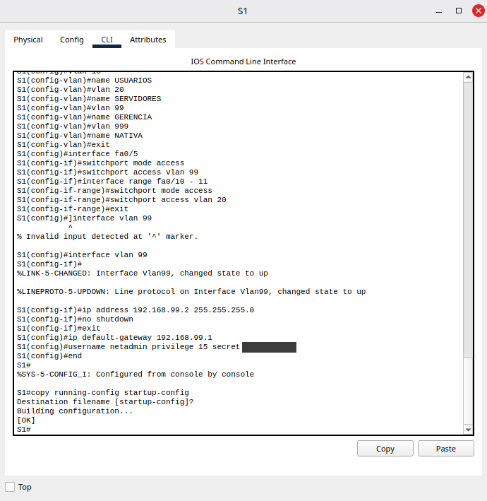 | 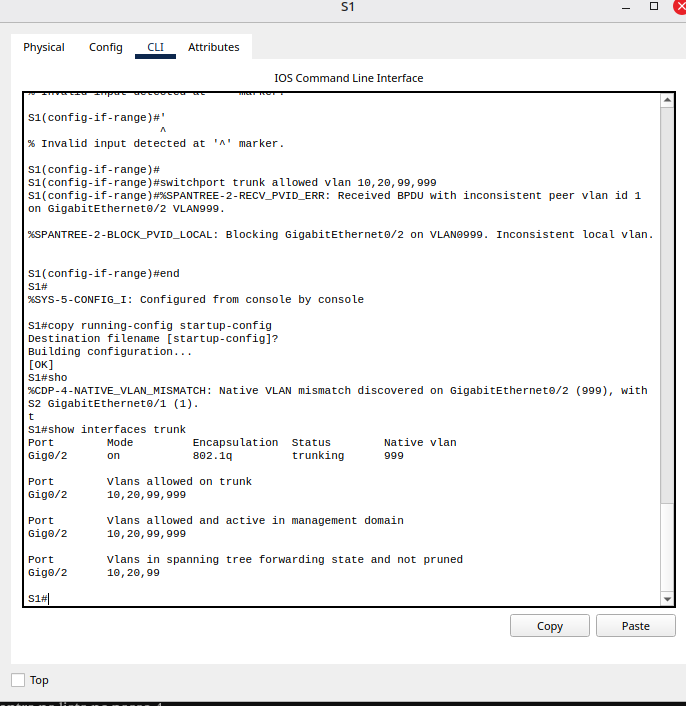 |

### 5.2 S2

Mesmas VLANs (criadas também aqui), PCs na VLAN 10 e trunk para o S1:

```text
enable
configure terminal
vlan 10
 name USUARIOS
vlan 20
 name SERVIDORES
vlan 99
 name GERENCIA
vlan 999
 name NATIVA
 exit

interface range fa0/1 - 2
 switchport mode access
 switchport access vlan 10
 exit

interface g0/1
 switchport mode trunk
 switchport trunk native vlan 999
 switchport trunk allowed vlan 10,20,99,999
 exit

interface vlan 99
 ip address 192.168.99.3 255.255.255.0
 no shutdown
 exit
ip default-gateway 192.168.99.1

username netadmin privilege 15 secret <senha-admin>
end
copy running-config startup-config
```

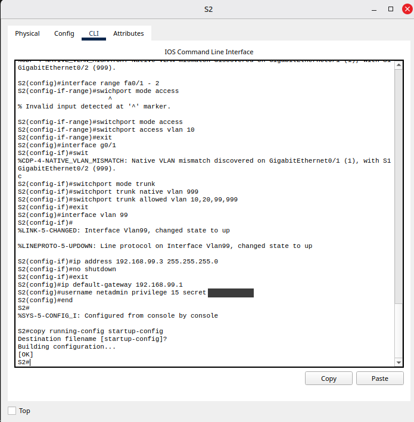

### 5.3 R1: subinterfaces, DHCP e NAT

```text
enable
configure terminal
! Interface física ligada, sem IP
interface g0/1
 no shutdown
 exit

! Uma subinterface por VLAN
interface g0/1.10
 description USUARIOS
 encapsulation dot1Q 10
 ip address 192.168.10.1 255.255.255.0
interface g0/1.20
 description SERVIDORES
 encapsulation dot1Q 20
 ip address 192.168.20.1 255.255.255.0
interface g0/1.99
 description GERENCIA
 encapsulation dot1Q 99
 ip address 192.168.99.1 255.255.255.0
 exit

! DHCP para os usuários
ip dhcp excluded-address 192.168.10.1 192.168.10.10
ip dhcp pool USUARIOS
 network 192.168.10.0 255.255.255.0
 default-router 192.168.10.1
 dns-server 198.51.100.10
 exit

! NAT/PAT: redes internas saem com o IP da G0/0
ip access-list standard NAT-INTERNO
 permit 192.168.10.0 0.0.0.255
 permit 192.168.20.0 0.0.0.255
 permit 192.168.99.0 0.0.0.255
 exit
ip nat inside source list NAT-INTERNO interface g0/0 overload
interface g0/0
 ip nat outside
interface g0/1.10
 ip nat inside
interface g0/1.20
 ip nat inside
interface g0/1.99
 ip nat inside
 exit

! Rota padrão para o ISP (recriada, ver problema 7.4)
ip route 0.0.0.0 0.0.0.0 203.0.113.2
end
copy running-config startup-config
```

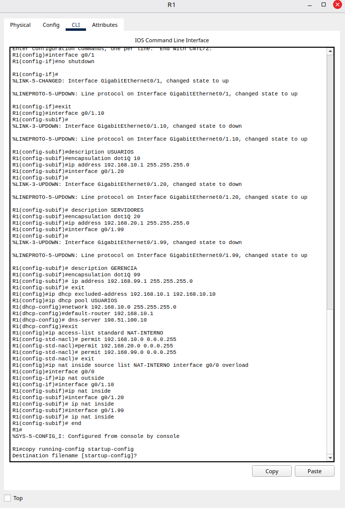

As subinterfaces mostram `changed state to down` seguido de `Line protocol ... up`: elas são criadas desligadas e sobem assim que recebem o encapsulamento.

### 5.4 Hosts

Configurados em **Desktop → IP Configuration**:

| Host | Modo | IP | Máscara | Gateway |
| --- | --- | --- | --- | --- |
| Admin-PC | Static | 192.168.99.10 | 255.255.255.0 | 192.168.99.1 |
| Web-Srv | Static | 192.168.20.10 | 255.255.255.0 | 192.168.20.1 |
| AAA-Srv | Static | 192.168.20.11 | 255.255.255.0 | 192.168.20.1 |
| PC1, PC2 | **DHCP** | - | - | - |

No Web-Srv, **Services → HTTP** fica ligado.

---

## 6. Verificação

### 6.1 VLANs e trunks

| S1 | S2 |
| --- | --- |
| 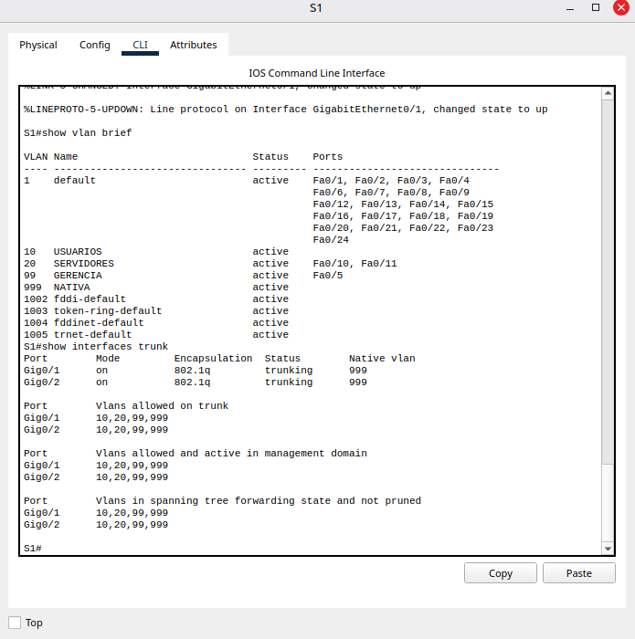 | 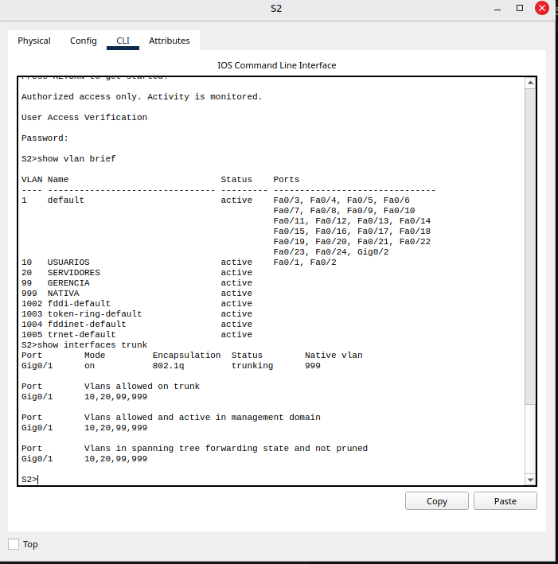 |

| Verificação | Resultado |
| --- | --- |
| S1: Fa0/5 na VLAN 99, Fa0/10 e Fa0/11 na VLAN 20 | ✅ |
| S2: Fa0/1 e Fa0/2 na VLAN 10 | ✅ |
| Trunks S1 G0/1, S1 G0/2 e S2 G0/1 em `trunking`, nativa 999 | ✅ |
| VLANs 10, 20, 99 e 999 em *forwarding* nos três trunks | ✅ |

> As portas em trunk não aparecem no `show vlan brief`: elas pertencem a todas as VLANs permitidas, não a uma só.

### 6.2 Subinterfaces do R1

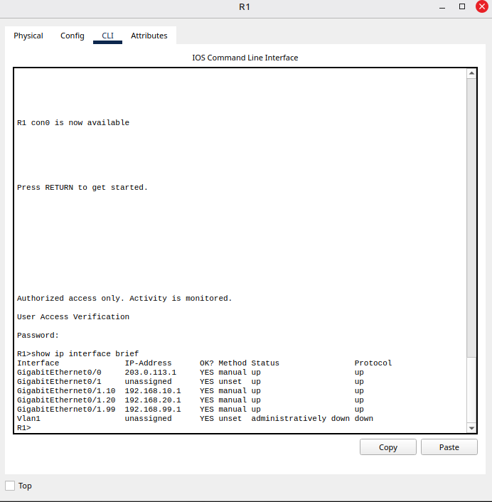

G0/1.10, G0/1.20 e G0/1.99 **up/up** com os IPs de gateway. A G0/1 física fica `unassigned`, como esperado no *router-on-a-stick*.

### 6.3 DHCP

| PC1 recebeu IP por DHCP | Concessões no R1 |
| --- | --- |
| 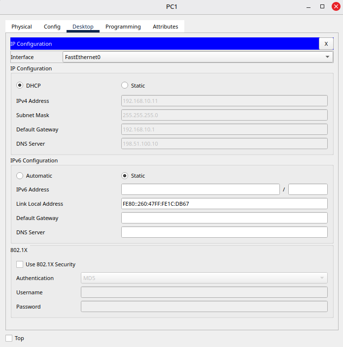 | 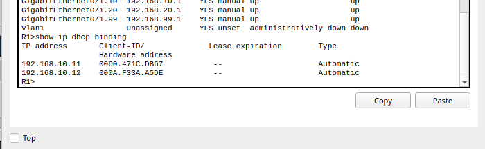 |

O PC1 recebeu **192.168.10.11** (o primeiro fora da faixa excluída), gateway 192.168.10.1 e DNS 198.51.100.10. O `show ip dhcp binding` mostra o PC1 (.11) e o PC2 (.12), cada um com seu MAC.

### 6.4 Roteamento entre VLANs

| Teste | Resultado |
| --- | --- |
| PC1 → Web-Srv (`ping 192.168.20.10`) | ✅ 4/4, **TTL=127** |
| PC1 → `http://192.168.20.10` no navegador | ✅ Página do Web-Srv |

| Ping | Navegador |
| --- | --- |
| 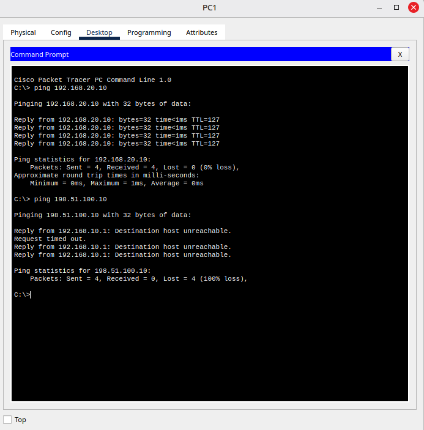 | 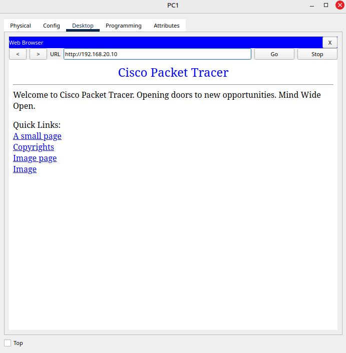 |

O TTL prova que o pacote **passou pelo roteador**: o Web-Srv responde com TTL 128, o R1 tira 1 ao encaminhar de uma VLAN para a outra, e a resposta chega com 127.

### 6.5 Internet e NAT

| Ping do PC1 ao Ext-Srv | Traduções no R1 |
| --- | --- |
| 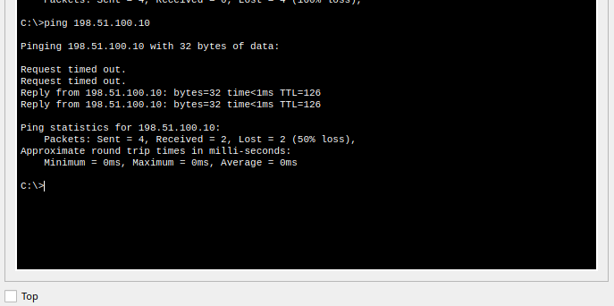 | 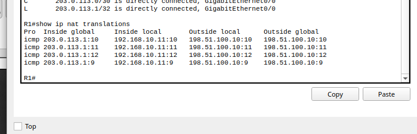 |

- O ping ao Ext-Srv chega com **TTL=126**: o pacote atravessou **dois** roteadores (R1 e ISP).
- Os dois primeiros pacotes se perdem enquanto o R1 e o ISP resolvem, por ARP, o MAC do próximo salto. A partir do terceiro, todos respondem.
- No `show ip nat translations`, o **inside local** `192.168.10.11` aparece traduzido para o **inside global** `203.0.113.1`. Os números `:9` a `:12` são os identificadores de cada ping: é com eles que o PAT separa várias conexões que usam o mesmo IP público.

| Destino | Roteadores no caminho | TTL na resposta |
| --- | --- | --- |
| Gateway do PC1 | 0 (o próprio R1 responde) | 255 |
| Web-Srv (outra VLAN) | 1 (R1) | 127 |
| Ext-Srv (internet) | 2 (R1 e ISP) | 126 |

### 6.6 SSH a partir da VLAN de gerência

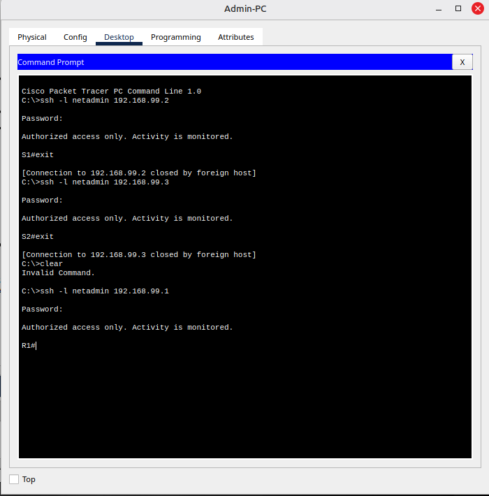

| Comando no Admin-PC | Resultado |
| --- | --- |
| `ssh -l netadmin 192.168.99.2` | ✅ Banner e prompt `S1#` |
| `ssh -l netadmin 192.168.99.3` | ✅ Banner e prompt `S2#` |
| `ssh -l netadmin 192.168.99.1` | ✅ Banner e prompt `R1#` |

Os três equipamentos aceitam o **mesmo usuário e a mesma senha**, e o SSH dos switches, que ficou pendente no Lab 1, agora funciona.

---

## 7. Problemas encontrados e soluções

### 7.1 Cabos de tipo errado

**Sintoma:** na conferência da topologia, o enlace R1 ↔ ISP estava contínuo e o R1 ↔ S1, tracejado.
**Causa:** os tipos de cabo estavam trocados: *straight-through* entre dois roteadores e *cross-over* entre roteador e switch.
**Por que ainda funcionava:** as portas Gigabit detectam e corrigem o tipo de cabo sozinhas (*auto-MDIX*), então o R1 ↔ ISP estava verde.
**Solução:** apagar os dois cabos e religar: *cross-over* em R1 G0/0 ↔ ISP G0/0 e *straight-through* em R1 G0/1 ↔ S1 G0/1.

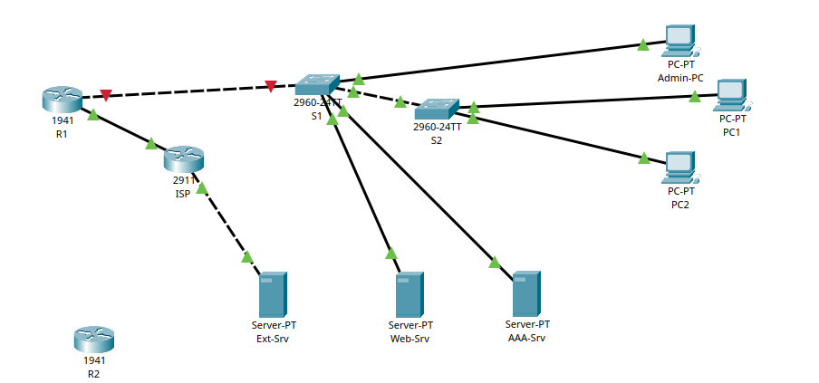

### 7.2 Bloco do trunk não aplicado no S1

**Sintoma:** depois de configurar o S1, os comandos do trunk não apareciam na tela, e a linha seguinte deu `% Invalid input`.
**Causa:** um `]` foi colado junto com `interface vlan 99`, e as linhas do trunk ficaram de fora do que foi colado.
**Solução:** colar de novo só o bloco `interface range g0/1 - 2 ... switchport trunk allowed vlan ...` e conferir com `show interfaces trunk`.

**Lição:** colar um bloco de cada vez e conferir o resultado antes do próximo. Outros erros de digitação do lab (`swichport`, um `'` sozinho) foram recusados pelo IOS com `% Invalid input` e corrigidos na linha seguinte.

### 7.3 VLAN nativa diferente entre S1 e S2

**Sintoma:** ao configurar o trunk do S1, apareceram:

```text
%SPANTREE-2-RECV_PVID_ERR: Received BPDU with inconsistent peer vlan id 1 on GigabitEthernet0/2 VLAN999.
%SPANTREE-2-BLOCK_PVID_LOCAL: Blocking GigabitEthernet0/2 on VLAN0999. Inconsistent local vlan.
%CDP-4-NATIVE_VLAN_MISMATCH: Native VLAN mismatch discovered on GigabitEthernet0/2 (999), with S2 GigabitEthernet0/1 (1).
```

E o `show interfaces trunk` mostrava só as VLANs 10, 20 e 99 em *forwarding*, sem a 999.

**Causa:** o S1 já usava a VLAN nativa 999, mas o S2 ainda usava a 1. Os dois lados não concordavam sobre qual VLAN passa sem etiqueta.
**Como o switch reagiu:** o **CDP** detectou a diferença e avisou, e o **STP** bloqueou a VLAN inconsistente naquele enlace, para não misturar o tráfego de duas VLANs.
**Solução:** configurar `switchport trunk native vlan 999` também no S2. As mensagens pararam e a 999 passou a aparecer em *forwarding*.


Esse comportamento é uma **proteção**: se o trunk aceitasse VLANs nativas diferentes, o tráfego de uma VLAN sairia na outra do lado de lá.

### 7.4 Sem saída para a internet: rota padrão perdida

**Sintoma:** o PC1 alcançava o Web-Srv, mas o ping ao Ext-Srv falhava com:

```text
Reply from 192.168.10.1: Destination host unreachable.
```

E o `show ip nat translations` vinha vazio.


**Diagnóstico:**
1. A resposta vinha do **gateway (192.168.10.1)**, e não era um `Request timed out`. Ou seja, o próprio R1 estava recusando o pacote, porque não sabia para onde mandá-lo.
2. O `show ip route` confirmou: **`Gateway of last resort is not set`**. A tabela só tinha as redes conectadas (`C`) e locais (`L`).
3. A tabela do NAT vazia era consequência: o pacote nunca saía pela G0/0, então não havia nada para traduzir.

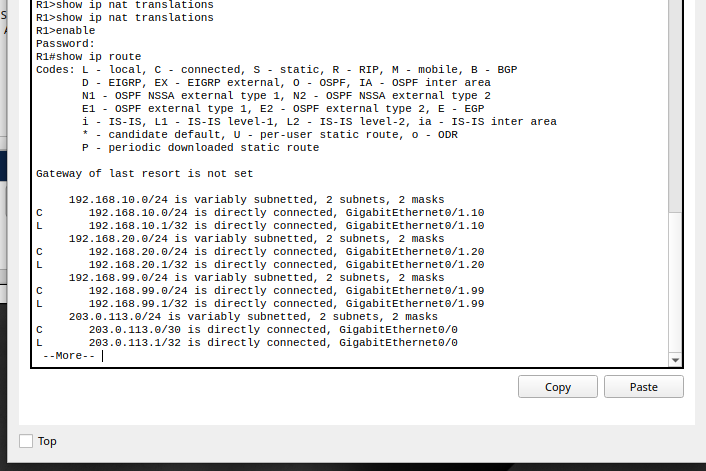

**Causa:** a rota padrão criada no Lab 1 não estava na configuração carregada.
**Solução:** recriar a rota e salvar:

```text
ip route 0.0.0.0 0.0.0.0 203.0.113.2
```

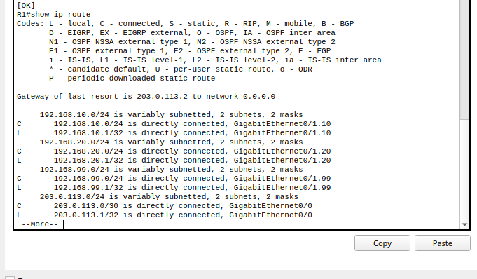

Depois disso, `Gateway of last resort is 203.0.113.2`, o ping ao Ext-Srv passou e o NAT registrou as traduções.

| Mensagem | O que indica |
| --- | --- |
| `Request timed out` | O pacote (ou a resposta) se perdeu no caminho e ninguém avisou |
| `Destination host unreachable` vindo do gateway | O roteador recusou o pacote: falta rota (ou uma ACL bloqueou) |

### 7.5 Tabela de NAT vazia mesmo com o NAT configurado

**Sintoma:** antes do problema 7.4 ser encontrado, o `show ip nat translations` vinha vazio logo depois de acessar o Web-Srv.
**Causa:** o NAT só cria traduções para tráfego que **sai** pela interface `outside`. O acesso ao Web-Srv é interno (VLAN 10 → VLAN 20) e não passa pelo NAT. Além disso, uma tradução de ping expira depois de cerca de 60 segundos.
**Solução:** gerar tráfego para a internet (`ping 198.51.100.10`) e rodar o `show ip nat translations` logo em seguida.

---

## 8. Limitações e riscos em aberto

Este lab cria a segmentação, mas ainda **não filtra nada**. Os riscos abaixo ficam registrados para os próximos labs:

| Risco | Situação atual | Onde será tratado |
| --- | --- | --- |
| **Todas as VLANs se alcançam** pelo R1 | O PC1 abre o Web-Srv e até tenta SSH nos switches. A VLAN separa, mas o roteador reconecta | Lab 4 (ACLs) |
| **Portas sem uso ligadas e na VLAN 1** | Qualquer equipamento plugado numa porta livre entra na rede | Lab 3 |
| **Servidor DHCP falso** | Nada impede outro servidor DHCP de responder aos PCs | Lab 3 (DHCP snooping) |
| **DTP ativo nas portas de acesso** | Uma porta de acesso ainda poderia negociar um trunk com um switch intruso | Lab 3 (`switchport nonegotiate`) |
| **Qualquer equipamento em qualquer porta de usuário** | Não há controle de MAC nas portas | Lab 3 (port security) |
| **SSH aceito de qualquer VLAN** | Basta saber a senha para gerenciar R1, S1 e S2 a partir de um PC de usuário | Lab 4 (ACL nas linhas VTY) |

Outras limitações:

- O DNS entregue pelo DHCP (`198.51.100.10`) aponta para o Ext-Srv, mas o serviço de DNS dele não foi configurado. Os testes usaram IPs, não nomes.
- As VLANs foram criadas manualmente nos dois switches. Numa rede com muitos switches, isso seria feito com VTP, que traz seus próprios riscos (um switch com revisão maior pode apagar as VLANs da rede inteira).

---

## 9. Lições aprendidas

- **VLAN não é firewall.** A segmentação define fronteiras, mas o roteamento entre VLANs reconecta tudo até que exista um filtro.
- **A VLAN nativa precisa ser igual nas duas pontas do trunk**, e o ideal é uma VLAN sem dispositivos. O CDP e o STP avisam e bloqueiam quando ela é diferente.
- **Switches não compartilham VLANs sozinhos.** Sem VTP, cada switch precisa ter as VLANs criadas manualmente.
- **A porta física do *router-on-a-stick* não tem IP.** Os gateways ficam nas subinterfaces, uma por VLAN.
- **O switch precisa de SVI e `ip default-gateway`** para ser gerenciado de fora da sua VLAN.
- **O TTL conta os roteadores no caminho:** 127 até o servidor interno, 126 até a internet.
- **Quem responde o erro diz onde está o problema.** `Destination host unreachable` vindo do gateway apontou direto para a tabela de rotas do R1.
- **NAT só aparece quando há tráfego saindo**, e as traduções expiram. Uma tabela vazia não significa necessariamente NAT quebrado.
- **Colar um bloco de cada vez** e conferir com `show` antes de seguir evita que um comando pulado passe despercebido.

---

## 10. Próximo passo

**Lab 3: segurança de switches (camada 2).** Atacar a rede sem proteção (servidor DHCP falso, switch clandestino tentando virar root do STP e notebook não autorizado numa porta de usuário), aplicar as proteções (portas sem uso desligadas numa VLAN isolada, DTP desligado, port security, BPDU Guard, root primary e DHCP snooping) e repetir os ataques para mostrar que foram bloqueados.
