# Lab 3: Segurança de Switches (Camada 2)

> Laboratório prático baseado no curso **Cisco Networking Academy: Network Defense**.
> Autor: **João Victor Paixão Zolim**
> Ferramenta: Cisco Packet Tracer

Terceiro lab da série de 7 que constrói, passo a passo, a rede de uma pequena empresa protegida com **defesa em profundidade**. Partindo da rede segmentada do [Lab 2](../Lab02-VLANs/), o lab protege as portas dos switches contra quem pluga um equipamento na rede.

O lab segue a lógica **atacar → proteger → atacar de novo**: primeiro três ataques reais contra a rede sem proteção, depois as defesas, e por fim os mesmos ataques repetidos para provar que foram bloqueados.

**Resultado:** o servidor DHCP falso deixa de entregar endereços, o switch clandestino é desligado assim que se conecta, o notebook não autorizado derruba a própria porta, e o root do STP passa a ser o switch escolhido de propósito.

| Ataque | Sem proteção | Com proteção | Quem barrou |
| --- | --- | --- | --- |
| Servidor DHCP falso | ✅ PC1 recebeu o gateway do atacante e ficou sem internet | ❌ PC1 só recebe IP do R1 | **DHCP snooping** |
| Switch clandestino | ✅ Virou root do STP da VLAN 10 | ❌ Porta desligada (err-disabled) | **Port security** e **BPDU Guard** |
| Notebook não autorizado | ✅ Alcançou servidor e gerência dos switches | ❌ Porta desligada (err-disabled) | **Port security** |

---

## Sumário

1. [Objetivo](#1-objetivo)
2. [Topologia](#2-topologia)
3. [Como funciona](#3-como-funciona)
4. [Parte A: atacando a rede sem proteção](#4-parte-a-atacando-a-rede-sem-proteção)
5. [Parte B: configurando as proteções](#5-parte-b-configurando-as-proteções)
6. [Parte C: atacando de novo](#6-parte-c-atacando-de-novo)
7. [Problemas encontrados e soluções](#7-problemas-encontrados-e-soluções)
8. [Limitações e riscos em aberto](#8-limitações-e-riscos-em-aberto)
9. [Lições aprendidas](#9-lições-aprendidas)
10. [Próximo passo](#10-próximo-passo)

---

## 1. Objetivo

Proteger a **camada 2** da rede, ou seja, as portas físicas dos switches. Em qualquer empresa existem tomadas de rede em salas de reunião, recepção e corredores. Se qualquer equipamento ligado nelas entrar na rede com os mesmos direitos de um PC da empresa, todas as outras camadas de defesa começam com o atacante já do lado de dentro.

---

## 2. Topologia

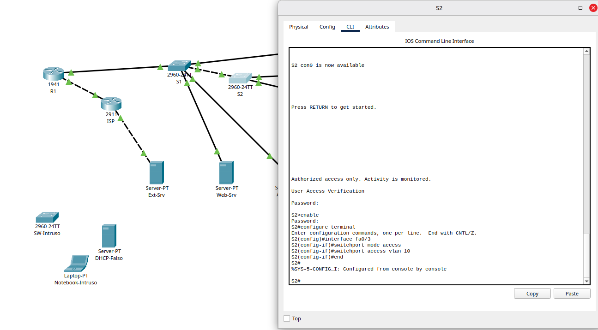

A topologia é a mesma do Lab 2, com três equipamentos "do atacante" e uma porta nova:

| Elemento | Onde | Papel no lab |
| --- | --- | --- |
| **S2 Fa0/3**, VLAN 10 | "Ponto de rede da sala de reunião" | Porta legítima, mas exposta, usada para os ataques |
| **DHCP-Falso** (Server-PT) | Ligado em S2 Fa0/3 | Ataque 1: servidor DHCP clandestino |
| **SW-Intruso** (2960) | Ligado em S2 Fa0/3 | Ataque 2: switch clandestino tentando virar root do STP |
| **Notebook-Intruso** (Laptop-PT) | Ligado em S2 Fa0/2, no lugar do PC2 | Ataque 3: equipamento não autorizado numa porta de usuário |
| VLAN **666** NAO-USADAS | S1 e S2 | VLAN "buraco negro" para as portas sem uso |

A porta Fa0/3 foi preparada no S2 antes dos ataques:

```text
interface fa0/3
 switchport mode access
 switchport access vlan 10
```

### Portas protegidas

| Switch | Portas | Uso | Proteções |
| --- | --- | --- | --- |
| S1 | Fa0/5 | Admin-PC | Port security (`shutdown`), PortFast, BPDU Guard, DTP desligado |
| S1 | Fa0/10, Fa0/11 | Web-Srv, AAA-Srv | Port security (`restrict`), PortFast, BPDU Guard, DTP desligado |
| S1 | Fa0/1-4, Fa0/6-9, Fa0/12-24 | Sem uso | VLAN 666 + `shutdown` |
| S1 | G0/1, G0/2 | Trunks | DTP desligado; G0/1 confiável no DHCP snooping |
| S2 | Fa0/1, Fa0/2, Fa0/3 | PC1, PC2, sala de reunião | Port security (`shutdown`), PortFast, BPDU Guard, DTP desligado, limite DHCP |
| S2 | Fa0/4-24, G0/2 | Sem uso | VLAN 666 + `shutdown` |
| S2 | G0/1 | Trunk | DTP desligado; confiável no DHCP snooping |

---

## 3. Como funciona

### 3.1 DHCP falso e DHCP snooping

**O ataque:** o DHCP não tem autenticação. Quando um PC pede um endereço (DISCOVER em broadcast), ele aceita a **primeira oferta** que chegar. Um servidor falso na mesma VLAN pode responder antes do legítimo e entregar:

- **o próprio IP como gateway:** todo o tráfego do PC passa pelo atacante (*man-in-the-middle*), ou some, se ele não repassar (negação de serviço);
- **o próprio IP como DNS:** o atacante decide para onde cada nome de site aponta.

**A defesa:** o **DHCP snooping** divide as portas do switch em dois tipos:

| Porta | Pode receber | Neste lab |
| --- | --- | --- |
| **Confiável** (*trusted*) | Mensagens de servidor (OFFER, ACK) | Uplinks em direção ao R1: S1 G0/1 e S2 G0/1 |
| **Não confiável** (padrão) | Só mensagens de cliente (DISCOVER, REQUEST) | Todas as portas de acesso |

Uma oferta DHCP que chega por porta não confiável é descartada. O switch também monta uma **tabela de concessões** (MAC, IP, VLAN, porta), usada depois por outras proteções, como o DAI. O `ip dhcp snooping limit rate 6` limita cada porta de acesso a 6 pacotes DHCP por segundo, o que freia o *DHCP starvation* (esgotar o pool com pedidos falsos).

**`no ip dhcp snooping information option`:** por padrão, o switch insere a **opção 82** nos pedidos DHCP. O servidor DHCP do IOS no R1 descarta pedidos com opção 82 que chegam sem um *relay* configurado, e os PCs ficariam sem IP. Por isso a inserção foi desligada.

### 3.2 Switch clandestino, root do STP e BPDU Guard

**O STP** (*Spanning Tree Protocol*) evita loops na camada 2. Os switches elegem um **root bridge** pela menor **Bridge ID** (prioridade + MAC), e todos os caminhos são calculados a partir dele.

**O ataque:** um switch com prioridade **0** anuncia BPDUs "melhores" que os de qualquer switch da rede e vence a eleição. A partir daí, ele decide quais enlaces ficam ativos e pode atrair o tráfego para passar por ele.

**As defesas:**

| Proteção | O que faz |
| --- | --- |
| `spanning-tree vlan ... root primary` | Escolhe o root **de propósito**: o S1 baixa a prioridade para 24576. Sem isso, o root é decidido pelo menor MAC, ou seja, por acaso |
| `spanning-tree bpduguard enable` | Porta de acesso que receber **qualquer BPDU** é desligada (err-disabled). PC e servidor nunca mandam BPDU, então quem manda é um switch que não deveria estar ali |
| `spanning-tree portfast` | A porta de host passa direto para *forwarding*, sem os ~30 s de espera do STP. Não é uma proteção, mas é usado junto com o BPDU Guard nas portas de host |

### 3.3 Equipamento não autorizado e port security

**O ataque:** qualquer equipamento plugado numa porta de usuário recebe IP por DHCP e passa a ter os mesmos acessos de um PC da empresa.

**A defesa:** o **port security** limita quais MACs podem usar cada porta:

| Comando | Função |
| --- | --- |
| `switchport port-security` | Ativa a proteção na porta |
| `maximum 1` | Só um MAC por porta |
| `mac-address sticky` | O switch **aprende** o primeiro MAC que passar e grava na configuração |
| `violation shutdown / restrict / protect` | O que fazer quando aparece um MAC diferente |

| Modo de violação | Descarta o tráfego do intruso | Gera log e conta | Desliga a porta |
| --- | --- | --- | --- |
| `protect` | ✅ | ❌ | ❌ |
| `restrict` | ✅ | ✅ | ❌ |
| `shutdown` (padrão) | ✅ | ✅ | ✅ (err-disabled) |

Os **servidores** usam `restrict`: um intruso numa porta de servidor é bloqueado e registrado, mas o servidor continua no ar. Com `shutdown`, o próprio ataque derrubaria o serviço.

### 3.4 DTP, VLAN hopping e portas sem uso

| Risco | Defesa |
| --- | --- |
| **VLAN hopping por *switch spoofing*:** o atacante se passa por switch e negocia um trunk por DTP, ganhando acesso a todas as VLANs | `switchport mode access` + `switchport nonegotiate` nas portas de acesso; `nonegotiate` também nos trunks |
| **VLAN hopping por dupla etiqueta** | VLAN nativa 999 sem dispositivos ([Lab 2](../Lab02-VLANs/README.md#vlan-nativa-e-vlan-hopping)) |
| **Tomadas livres:** portas sem uso ligadas e na VLAN 1 | Portas sem uso na VLAN 666 (sem gateway, sem nada) e em `shutdown` |

---

## 4. Parte A: atacando a rede sem proteção

### 4.1 Ataque 1: servidor DHCP falso

O DHCP-Falso foi ligado na Fa0/3 com IP `192.168.10.250` e um pool que entrega **ele mesmo** como gateway e DNS:

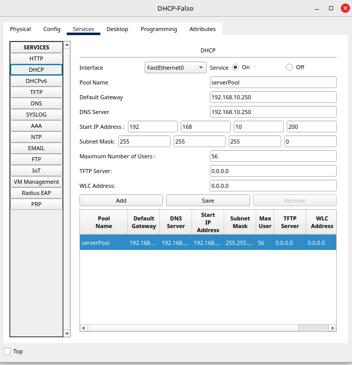

No PC1, o IP foi renovado (Static → DHCP) até o servidor falso responder primeiro:

| PC1 com IP do atacante | Sem saída para a internet |
| --- | --- |
| 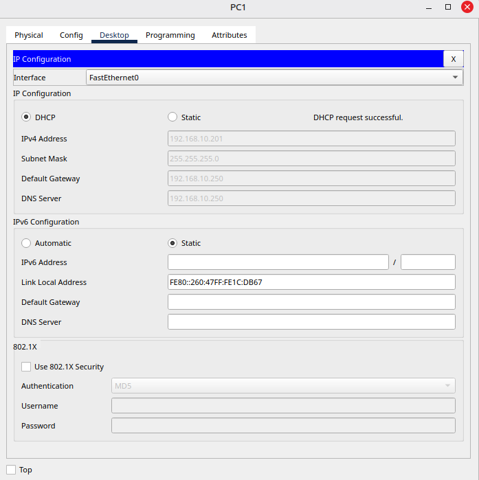 | 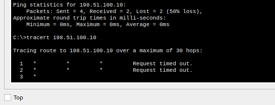 |

- O PC1 recebeu `192.168.10.201`, gateway **`192.168.10.250`** e DNS **`192.168.10.250`**, com a mensagem "DHCP request successful". Para o usuário, nada parece errado.
- O `tracert` para a internet dá timeout em todos os saltos. O servidor falso não roteia, então o tráfego do PC1 **some no primeiro salto**: é a negação de serviço. Um atacante real usaria uma máquina que repassa o tráfego, e o ataque viraria *man-in-the-middle* sem o usuário perceber.

Com o DHCP falso desligado e o IP renovado, o caminho volta ao normal, em 3 saltos:

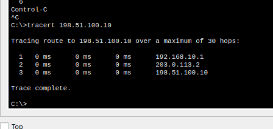

| | Gateway | Tracert |
| --- | --- | --- |
| DHCP falso | 192.168.10.250 (atacante) | Timeout no salto 1 |
| DHCP legítimo | 192.168.10.1 (R1) | R1 → ISP → Ext-Srv |

### 4.2 Ataque 2: switch clandestino virando root

O SW-Intruso foi ligado na Fa0/3 e configurado com a prioridade mínima:

```text
spanning-tree vlan 1 priority 0
```

| Configuração do intruso | STP da VLAN 10 visto pelo S1 |
| --- | --- |
| 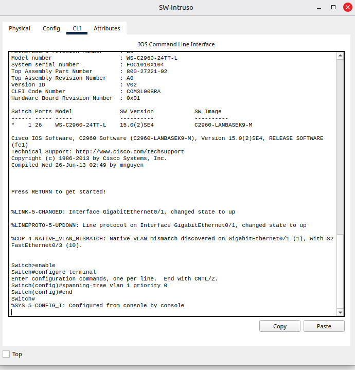 | 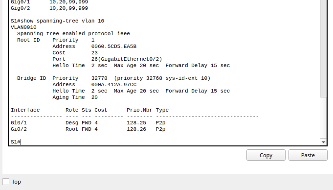 |

| Campo (S1) | Valor | Leitura |
| --- | --- | --- |
| Root ID Priority | **1** | Prioridade 0 do intruso + 1 do *sys-id-ext*: ele anuncia a VLAN 1, e a porta de acesso do S2 levou esses BPDUs para dentro da VLAN 10 |
| Root ID Address | 0060.5CD5.EA5B | Bridge ID do SW-Intruso |
| Cost | **23** | 4 (S1 → S2, Gigabit) + 19 (S2 → intruso, FastEthernet): o root está atrás do S2 |
| Bridge ID do S1 | 32778 | O S1 perdeu a eleição |

Um switch plugado numa tomada da sala de reunião passou a **comandar o STP** da VLAN de usuários.

No console do intruso também apareceu `%CDP-4-NATIVE_VLAN_MISMATCH ... (1), with S2 FastEthernet0/3 (10)`. O CDP avisa a diferença, mas não bloqueia nada.

#### Achado: o root "normal" também era escolhido por acaso

Com o intruso desconectado, o root voltou para um switch da empresa, mas para o **S2**, e não para o S1:

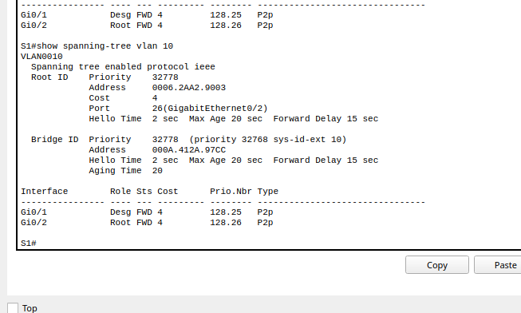

S1 e S2 tinham a mesma prioridade (32768 + 10 = 32778), e o desempate foi pelo **menor MAC**: `0006.2AA2.9003` (S2) é menor que `000A.412A.97CC` (S1). Ou seja, o switch de acesso, na ponta da rede, era o root. Isso justifica o `root primary` no S1.

### 4.3 Ataque 3: notebook não autorizado

O PC2 foi desligado da Fa0/2 e o Notebook-Intruso foi ligado no lugar, com IP por DHCP:

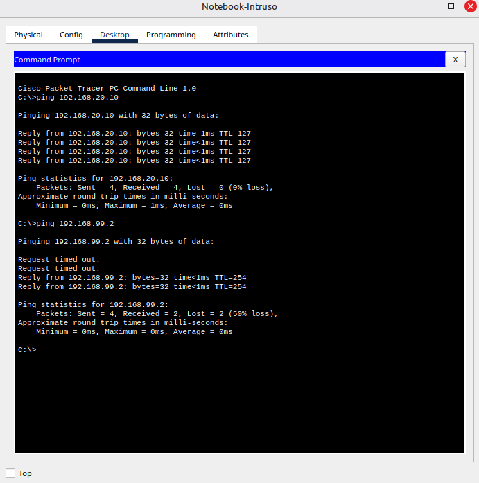

| Teste no notebook | Resultado | Leitura |
| --- | --- | --- |
| Recebeu IP do R1 | ✅ | O DHCP legítimo atende qualquer um |
| `ping 192.168.20.10` (Web-Srv) | ✅ TTL 127 | Alcança os servidores pelo R1 |
| `ping 192.168.99.2` (gerência do S1) | ✅ TTL 254 | Alcança a gerência: o IOS do switch começa em 255, menos 1 do R1. O próximo passo seria tentar SSH |

---

## 5. Parte B: configurando as proteções

Antes de configurar, a rede foi **limpa**: notebook fora e PC2 de volta na Fa0/2, DHCP-Falso e SW-Intruso desconectados. O *sticky* aprende o **primeiro** MAC que passar em cada porta. Se o notebook ainda estivesse ligado, ele viraria o "dono" legítimo da Fa0/2.

### 5.1 S1

```text
vlan 666
 name NAO-USADAS
 exit

! Portas sem uso: VLAN buraco negro e desligadas
interface range fa0/1 - 4 , fa0/6 - 9 , fa0/12 - 24
 switchport mode access
 switchport access vlan 666
 shutdown
 exit

! Porta do Admin-PC
interface fa0/5
 switchport mode access
 switchport nonegotiate
 switchport port-security
 switchport port-security maximum 1
 switchport port-security mac-address sticky
 switchport port-security violation shutdown
 spanning-tree portfast
 spanning-tree bpduguard enable
 exit

! Portas dos servidores: restrict (bloqueia o intruso sem derrubar o servidor)
interface range fa0/10 - 11
 switchport mode access
 switchport nonegotiate
 switchport port-security
 switchport port-security maximum 1
 switchport port-security mac-address sticky
 switchport port-security violation restrict
 spanning-tree portfast
 spanning-tree bpduguard enable
 exit

! Trunks sem negociação DTP
interface range g0/1 - 2
 switchport nonegotiate
 exit

! S1 é o root do STP de propósito
spanning-tree vlan 10,20,99 root primary

! DHCP snooping: só o uplink para o R1 é confiável
ip dhcp snooping
ip dhcp snooping vlan 10
no ip dhcp snooping information option
interface g0/1
 ip dhcp snooping trust
 exit
end
copy running-config startup-config
```

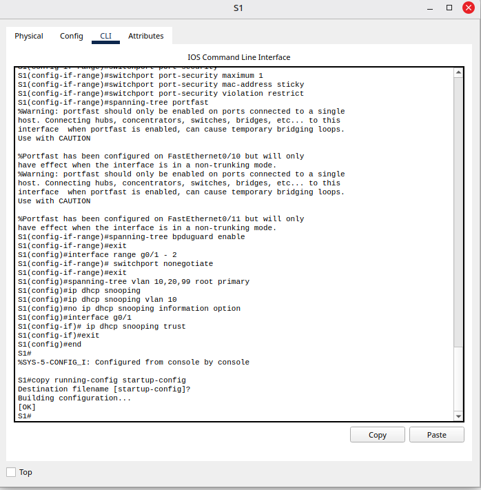

Os avisos `%Warning: portfast should only be enabled on ports connected to a single host` são esperados: o IOS lembra que PortFast é só para portas de host.

### 5.2 S2

```text
vlan 666
 name NAO-USADAS
 exit

interface range fa0/4 - 24 , g0/2
 switchport mode access
 switchport access vlan 666
 shutdown
 exit

! PC1, PC2 e sala de reunião
interface range fa0/1 - 3
 switchport mode access
 switchport access vlan 10
 switchport nonegotiate
 switchport port-security
 switchport port-security maximum 1
 switchport port-security mac-address sticky
 switchport port-security violation shutdown
 spanning-tree portfast
 spanning-tree bpduguard enable
 ip dhcp snooping limit rate 6
 exit

interface g0/1
 switchport nonegotiate
 ip dhcp snooping trust
 exit

ip dhcp snooping
ip dhcp snooping vlan 10
no ip dhcp snooping information option
end
copy running-config startup-config
```

| Configuração (faltou o PortFast) | PortFast corrigido |
| --- | --- |
| 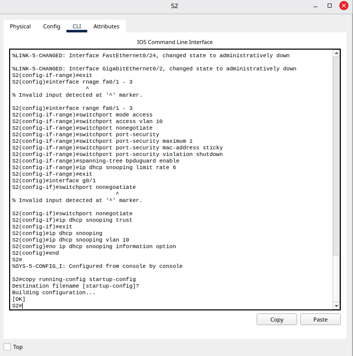 | 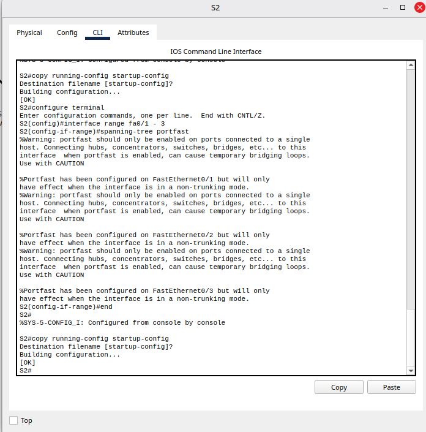 |

Ver o [problema 7.2](#72-portfast-faltando-sem-nenhum-erro).

### 5.3 Ensinando os MACs legítimos (sticky)

Cada host fez um ping para o seu gateway, para o switch aprender o MAC dele. Depois, `copy running-config startup-config` nos dois switches gravou os MACs na configuração.

| S1 | S2 |
| --- | --- |
| 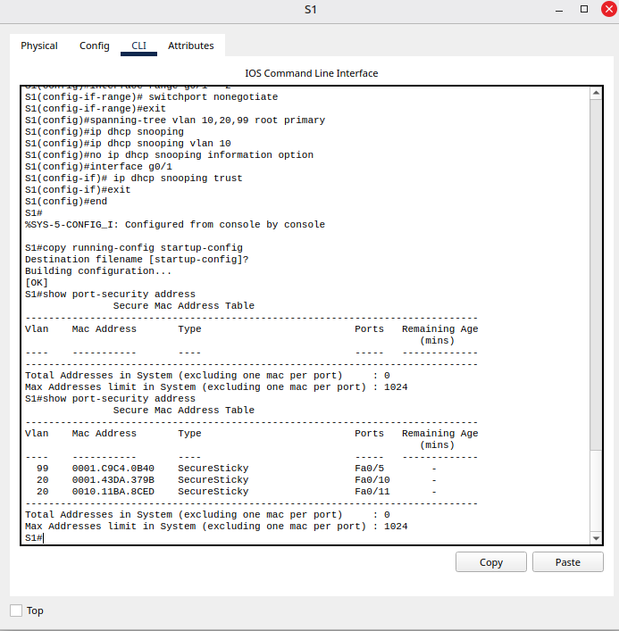 | 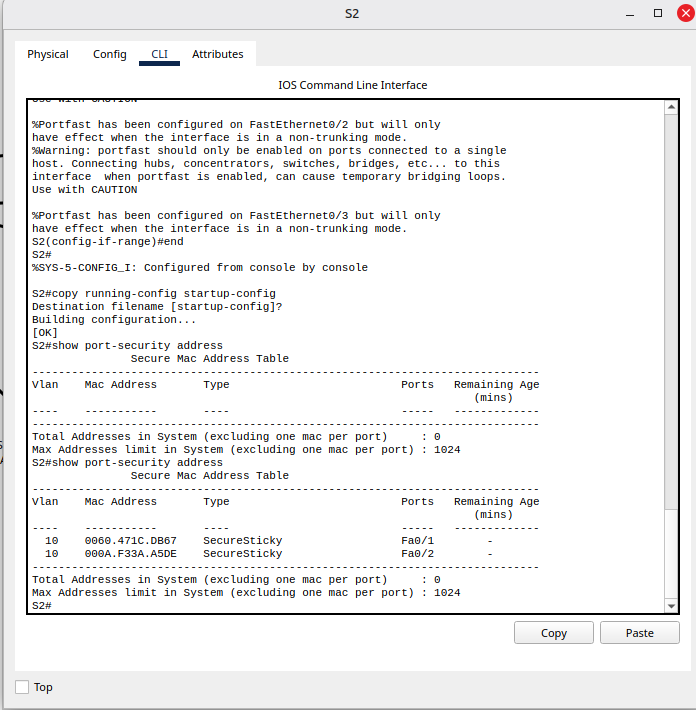 |

| Switch | Porta | VLAN | MAC aprendido | Equipamento |
| --- | --- | --- | --- | --- |
| S1 | Fa0/5 | 99 | 0001.C9C4.0B40 | Admin-PC |
| S1 | Fa0/10 | 20 | 0001.43DA.379B | Web-Srv |
| S1 | Fa0/11 | 20 | 0010.11BA.8CED | AAA-Srv |
| S2 | Fa0/1 | 10 | 0060.471C.DB67 | PC1 |
| S2 | Fa0/2 | 10 | 000A.F33A.A5DE | PC2 |

Na primeira consulta a tabela veio vazia (ver [problema 7.1](#71-tabela-do-sticky-vazia)). O `Total Addresses ... : 0` no rodapé não é erro: o contador ignora 1 MAC por porta (*excluding one mac per port*).

---

## 6. Parte C: atacando de novo

### 6.1 Ataque 1 de novo: DHCP falso bloqueado

Com o DHCP-Falso ligado na Fa0/3 e o serviço em **On**, o PC1 renovou o IP várias vezes e só recebeu ofertas do R1:

| PC1 só com o R1 | DHCP snooping no S2 |
| --- | --- |
| 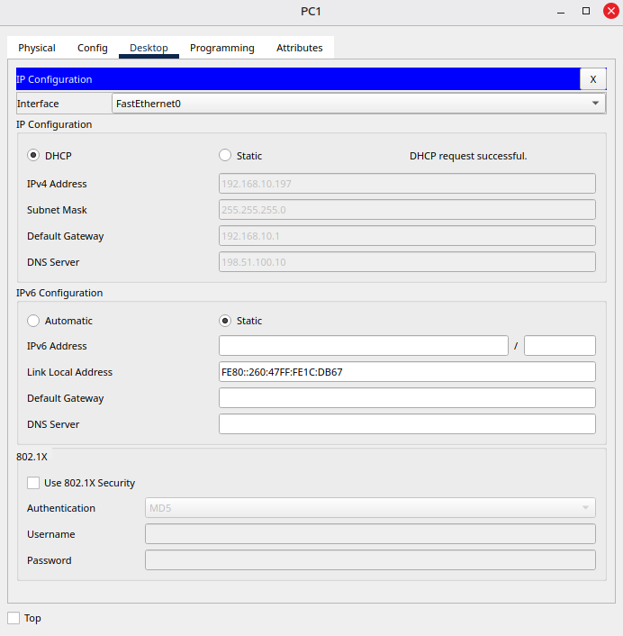 | 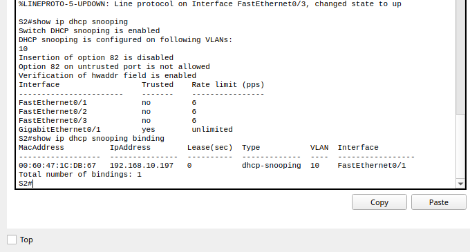 |

| | Parte A | Parte C |
| --- | --- | --- |
| Gateway do PC1 | **192.168.10.250** (atacante) | **192.168.10.1** (R1) ✅ |
| DNS do PC1 | 192.168.10.250 | 198.51.100.10 ✅ |

O `show ip dhcp snooping` mostra Fa0/1-3 como **não confiáveis**, com limite de 6 pacotes/s, e a Gi0/1 como a única **confiável**. O `show ip dhcp snooping binding` registra o PC1 (`00:60:47:1C:DB:67`) com o IP `192.168.10.197` na VLAN 10, porta Fa0/1.

> Nesse ataque, o port security da Fa0/3 aprendeu o MAC do próprio DHCP-Falso: a porta estava vazia, e ele foi o primeiro a falar. Quem bloqueou o ataque foi o DHCP snooping. Cada proteção cuida de um tipo de ameaça (ver [limitações](#8-limitações-e-riscos-em-aberto)).

### 6.2 Ataque 2 de novo: switch clandestino bloqueado

**Primeira tentativa: o port security chegou antes.** Com o MAC do DHCP-Falso ainda gravado na Fa0/3, o primeiro quadro do SW-Intruso já tinha outro MAC:

```text
%PORT_SECURITY-2-PSECURE_VIOLATION: Security violation occurred, caused by MAC address 0010.11B3.ED19 on port FastEthernet0/3.
```

| Violação no console | Status das portas |
| --- | --- |
| 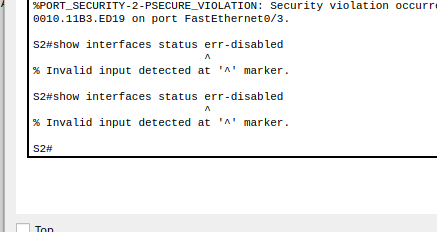 | 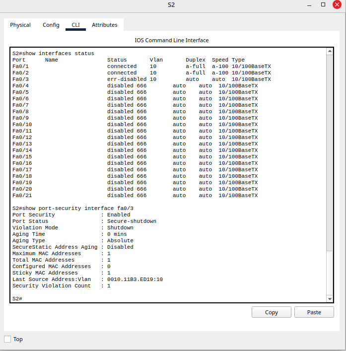 |

- `show interfaces status`: Fa0/3 em **err-disabled**; Fa0/4 em diante em `disabled` na VLAN 666.
- `show port-security interface fa0/3`: `Secure-shutdown`, `Sticky MAC Addresses : 1` (o DHCP-Falso), `Last Source Address : 0010.11B3.ED19` (o intruso) e `Security Violation Count : 1`.

O MAC da violação (`0010.11B3.ED19`) é diferente do endereço que o intruso usava como root na Parte A (`0060.5CD5.EA5B`): o quadro sai com o MAC da porta do switch, e a Bridge ID usa o MAC base do equipamento.

**O root continua sendo o S1:**

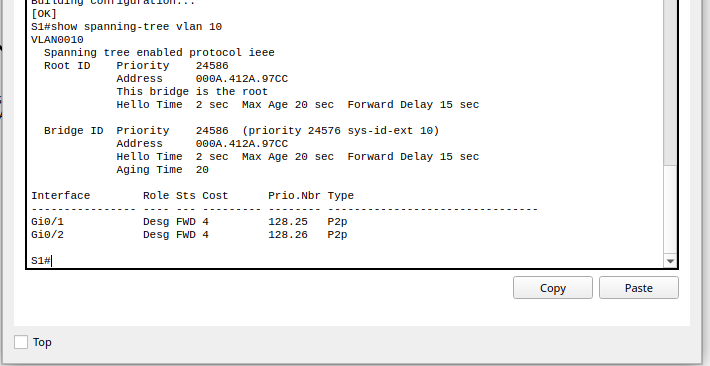

`This bridge is the root`, prioridade **24586** (24576 do `root primary` + 10 da VLAN), com as duas portas em `Desg FWD`.

**Segunda tentativa: o BPDU Guard sozinho.** Para ver o BPDU Guard agir, o MAC antigo foi apagado da Fa0/3 e a porta foi reativada:

```text
interface fa0/3
 no switchport port-security mac-address sticky 00E0.8F83.8475
 shutdown
 no shutdown
```

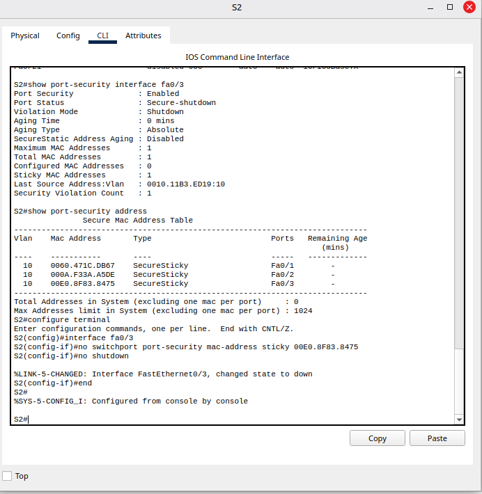

Com a porta limpa, o SW-Intruso foi religado. Assim que o primeiro BPDU chegou:

```text
%SPANTREE-2-BLOCK_BPDUGUARD: Received BPDU on port FastEthernet0/3 with BPDU Guard enabled. Disabling port.
%PM-4-ERR_DISABLE: bpduguard error detected on 0/3, putting 0/3 in err-disable state
```

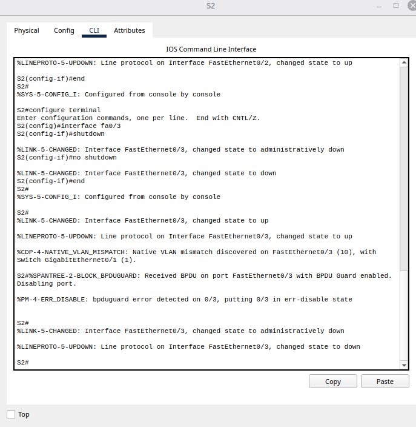

As duas proteções barram o mesmo ataque por motivos diferentes: o **port security** porque o MAC não é o autorizado, e o **BPDU Guard** porque uma porta de host recebeu BPDU. Se uma falhar, a outra ainda segura.

### 6.3 Ataque 3 de novo: notebook bloqueado

O PC2 saiu da Fa0/2 e o Notebook-Intruso entrou no lugar. Ao primeiro quadro do notebook:

```text
%PM-4-ERR_DISABLE: psecure-violation error detected on Fa0/2, putting Fa0/2 in err-disable state.
%PORT_SECURITY-2-PSECURE_VIOLATION: Security violation occurred, caused by MAC address 00D0.FF99.D4C4 on port FastEthernet0/2.
```

| Notebook sem rede | Violação e recuperação no S2 |
| --- | --- |
| 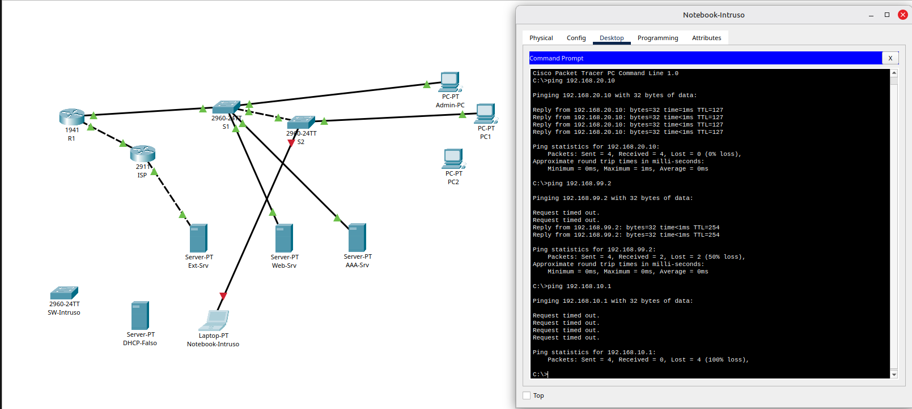 | 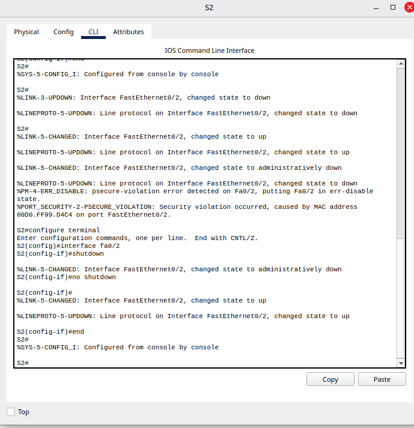 |

No notebook, o `ping 192.168.10.1` dá **100% de perda**, e o cabo fica vermelho nas duas pontas. (Os pings com sucesso que aparecem acima na mesma tela são da Parte A.)

### 6.4 Recuperando uma porta em err-disabled

Primeiro o intruso é retirado e o equipamento legítimo é religado. Depois:

```text
interface fa0/2
 shutdown
 no shutdown
```

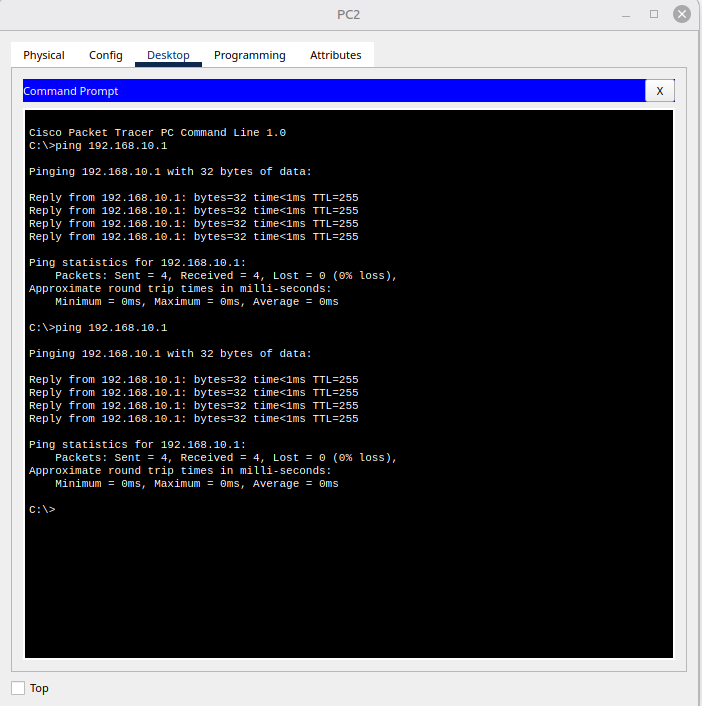

A Fa0/2 volta a `up` e o PC2 pinga o gateway com 4/4. Sem retirar o intruso antes, a porta cairia de novo na hora.

---

## 7. Problemas encontrados e soluções

### 7.1 Tabela do sticky vazia

**Sintoma:** logo depois de configurar o port security, o `show port-security address` voltou vazio nos dois switches.
**Causa:** o *sticky* só aprende o MAC quando o equipamento **manda tráfego** pela porta depois que a proteção está ligada.
**Solução:** um ping de cada host para o gateway. Os 5 MACs apareceram como `SecureSticky` e foram gravados com `copy running-config startup-config`.

### 7.2 PortFast faltando, sem nenhum erro

**Sintoma:** ao revisar a saída do S2, a linha `spanning-tree portfast` não aparecia no bloco das portas Fa0/1-3.
**Causa:** a linha ficou de fora do que foi colado. Um comando que **falta** não gera mensagem de erro nenhuma.
**Impacto:** o BPDU Guard funciona mesmo assim (foi ativado direto na porta), mas cada equipamento ligado esperaria ~30 s do STP para ter rede.
**Solução:** aplicar `spanning-tree portfast` em `interface range fa0/1 - 3`.
**Lição:** conferir a saída do bloco colado linha por linha, ou validar com `show running-config interface fa0/1`.

### 7.3 `show interfaces status err-disabled` não existe no Packet Tracer

**Sintoma:** `% Invalid input detected at '^' marker.`
**Solução:** usar `show interfaces status` (a coluna Status mostra `err-disabled`) e `show port-security interface fa0/3`.

### 7.4 O port security agiu antes do BPDU Guard

**Sintoma:** ao ligar o SW-Intruso, a porta caiu por `PSECURE_VIOLATION`, e não por BPDU Guard.
**Causa:** a Fa0/3 já tinha aprendido, como sticky, o MAC do DHCP-Falso do ataque anterior. O primeiro quadro do intruso, com outro MAC, já era uma violação.
**Solução, para testar o BPDU Guard isoladamente:** `no switchport port-security mac-address sticky <MAC>` na porta, `shutdown` / `no shutdown` e religar o intruso.

### 7.5 Porta em err-disabled só volta com `shutdown` + `no shutdown`

**Sintoma:** depois de apagar o MAC sticky, só o `no shutdown` foi aplicado, e a porta continuou parada.
**Causa:** uma porta em **err-disabled** não volta sozinha nem só com `no shutdown`. É preciso desligar e ligar de novo.
**Solução:** `shutdown` seguido de `no shutdown`, depois de remover a causa (o intruso).

### 7.6 PC1 recebendo IPs fora da ordem do pool (.200, .197)

**Sintoma:** depois do ataque de DHCP falso, o PC1 voltou com `192.168.10.200` e depois com `192.168.10.197`, e não com o `.11` de antes. O gateway (.1) e o DNS (198.51.100.10) eram do R1.
**Causa:** no DHCP, o cliente pode **pedir um endereço específico** (por exemplo, um que ele usou antes). Se o endereço está dentro do pool e livre, o servidor aceita.
**Impacto:** nenhum. Mas é um lembrete de que o IP sozinho não identifica uma máquina: o vínculo confiável é o MAC na tabela do DHCP snooping.

### 7.7 Erros de digitação

`interface rnage`, `switchport nonegoatiate`: recusados pelo IOS com `% Invalid input` e corrigidos na linha seguinte.

---

## 8. Limitações e riscos em aberto

| Limitação | Por quê | Onde será tratado |
| --- | --- | --- |
| **Port security não impede MAC clonado** | Um atacante que descubra o MAC do PC2 (etiqueta do equipamento, captura de tráfego) pode configurar o mesmo MAC no notebook e passar | Lab 5 (AAA): autenticação na porta com **802.1X** |
| **O sticky confia em quem chega primeiro** | Na Fa0/3, o primeiro MAC aprendido foi o do DHCP-Falso. Uma porta livre "ensinada" por um intruso passa a confiar nele | Processo: aprender os MACs com a rede limpa, ou cadastrar os MACs manualmente (`mac-address <MAC>` sem sticky) |
| **As VLANs continuam se alcançando** | As proteções são de camada 2. Um equipamento autorizado na VLAN 10 ainda alcança servidores e gerência pelo R1 | Lab 4 (ACLs) |
| **ARP spoofing** | O DAI (*Dynamic ARP Inspection*), que usa a tabela do DHCP snooping, não foi configurado | Extensão futura |
| **Recuperação manual** | Cada porta em err-disabled precisa de um administrador (`shutdown` / `no shutdown`). Em produção, `errdisable recovery cause ...` religa sozinho depois de um tempo | Decisão de operação |
| **Logs só no console** | As violações aparecem no console do switch e se perdem | Lab 5 (Syslog) |
| **Sem Root Guard** | O `root primary` + BPDU Guard cobrem as portas de acesso, mas um BPDU superior vindo por um trunk ainda seria aceito | Extensão futura |

---

## 9. Lições aprendidas

- **Atacar antes de proteger** mostra o tamanho do risco e prova que a proteção funciona. Os prints de antes e depois são a melhor evidência.
- **DHCP não tem autenticação.** O primeiro servidor a responder ganha, e o DHCP snooping é o que separa quem pode responder.
- **O root do STP precisa ser escolhido de propósito.** Sem `root primary`, ganhou o switch com menor MAC, e depois o switch do atacante.
- **Port security não é identidade.** Ele confia em um endereço que pode ser clonado e aprende o primeiro MAC que aparecer.
- **Defesa em profundidade na prática:** o switch clandestino foi barrado pelo port security *e* pelo BPDU Guard, por motivos diferentes.
- **`restrict` nos servidores, `shutdown` nos usuários:** a proteção não pode virar uma forma de derrubar o serviço.
- **err-disabled exige ação humana:** remover a causa e depois `shutdown` / `no shutdown`.
- **Comando faltando não dá erro.** Ler a saída do que foi colado é tão importante quanto ler as mensagens de erro.

---

## 10. Próximo passo

**Lab 4: listas de controle de acesso (ACLs).** Até aqui, qualquer equipamento autorizado alcança todas as VLANs, inclusive a gerência dos switches. O Lab 4 filtra o tráfego entre as VLANs no R1 (usuários só acessam os serviços necessários dos servidores) e restringe o SSH dos equipamentos à VLAN de gerência.
