# Lab 4: Listas de Controle de Acesso (ACLs)

> Laboratório prático baseado no curso **Cisco Networking Academy: Network Defense** (Módulo 4).
> Autor: **João Victor Paixão Zolim**
> Ferramenta: Cisco Packet Tracer

Quarto lab da série de 7 que constrói, passo a passo, a rede de uma pequena empresa protegida com **defesa em profundidade**. Os labs anteriores separaram a rede em VLANs ([Lab 2](../Lab02-VLANs/)) e protegeram as portas dos switches ([Lab 3](../Lab03-SegurancaSwitches/)), mas o R1 ainda roteava **tudo para todos**: um PC de usuário alcançava os servidores e até o login dos switches. Este lab transforma a política de acesso em três ACLs.

**Resultado:** usuários só acessam o site interno e a internet; só o Admin-PC consegue fazer login em R1, S1 e S2; e o R1 descarta pacotes vindos da internet com endereço de origem falsificado.

| ACL | Tipo | Onde | Protege contra |
| --- | --- | --- | --- |
| `USUARIOS-IN` | Estendida | R1 G0/1.10, **entrada** | Usuários alcançando servidores e gerência |
| `ADMIN-SSH` | Padrão | Linhas VTY de R1, S1 e S2 (`access-class`) | Login nos equipamentos a partir de qualquer lugar que não seja o Admin-PC |
| `ANTI-SPOOF` | Estendida | R1 G0/0, **entrada** (lado da internet) | Pacotes da internet com origem privada, loopback ou multicast |

| Teste | Antes | Depois |
| --- | --- | --- |
| PC1 → AAA-Srv (ping) | ✅ Responde | ❌ Bloqueado |
| PC1 → gerência do S1 (ping) | ✅ Responde | ❌ Bloqueado |
| PC1 → SSH no S1 | ✅ Chegou ao prompt `S1#` | ❌ `Connection timed out` |
| PC1 → SSH no R1 (pelo IP do gateway) | ✅ Pede senha | ❌ `Connection refused` |
| ISP → SSH no R1 | ✅ Funcionava no Lab 1 | ❌ `Connection refused` |
| ISP → R1 com origem falsa `10.10.10.1` | ✅ `!!!!!` | ❌ `UUUUU` |
| PC1 → site interno (HTTP) e internet | ✅ | ✅ Continua funcionando |
| Admin-PC → SSH em R1, S1, S2 e ping aos usuários | ✅ | ✅ Continua funcionando |

---

## Sumário

1. [Objetivo](#1-objetivo)
2. [Topologia e política de acesso](#2-topologia-e-política-de-acesso)
3. [Como funciona](#3-como-funciona)
4. [Antes: o que um usuário conseguia fazer](#4-antes-o-que-um-usuário-conseguia-fazer)
5. [ACL 1: USUARIOS-IN](#5-acl-1-usuarios-in)
6. [ACL 2: ADMIN-SSH](#6-acl-2-admin-ssh)
7. [ACL 3: ANTI-SPOOF](#7-acl-3-anti-spoof)
8. [Visão final das ACLs](#8-visão-final-das-acls)
9. [Problemas encontrados e soluções](#9-problemas-encontrados-e-soluções)
10. [Limitações e riscos em aberto](#10-limitações-e-riscos-em-aberto)
11. [Lições aprendidas](#11-lições-aprendidas)
12. [Próximo passo](#12-próximo-passo)

---

## 1. Objetivo

Transformar uma regra de negócio ("usuário só acessa o que precisa; só o administrador gerencia a rede") em filtros no roteador e nos switches, e provar com testes e contadores que cada filtro faz exatamente o que deveria, sem quebrar o que precisa continuar funcionando.

Na defesa em profundidade, essa é a camada de **filtro de tráfego**: ela atua nas fronteiras que as VLANs criaram.

---

## 2. Topologia e política de acesso

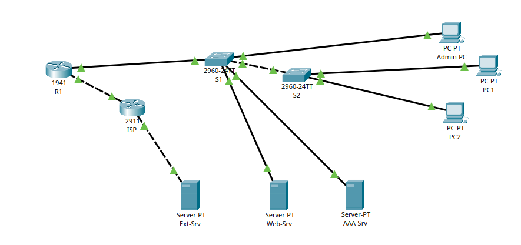

A topologia é a mesma do Lab 3, sem os equipamentos intrusos. Endereçamento:

| Rede | VLAN | Hosts |
| --- | --- | --- |
| 192.168.10.0/24 | 10 (usuários) | PC1, PC2 (DHCP) |
| 192.168.20.0/24 | 20 (servidores) | Web-Srv `.10`, AAA-Srv `.11` |
| 192.168.99.0/24 | 99 (gerência) | R1 `.1`, S1 `.2`, S2 `.3`, Admin-PC `.10` |
| 203.0.113.0/30 | - | R1 G0/0 `.1` ↔ ISP `.2` |
| 198.51.100.0/24 | - | Ext-Srv `.10` ("internet") |

### Política de acesso

| Origem | Destino | Regra |
| --- | --- | --- |
| Usuários | Web-Srv, HTTP e HTTPS | ✅ Permitido |
| Usuários | Internet | ✅ Permitido |
| Usuários | R1 (ping ao gateway) | ✅ Permitido, para diagnóstico |
| Usuários | AAA-Srv e qualquer outro acesso aos servidores (incluindo ping) | ❌ Bloqueado |
| Usuários | Gerência (VLAN 99) | ❌ Bloqueado |
| Admin-PC | Ping aos usuários | ✅ Permitido |
| Qualquer origem, exceto o Admin-PC | Login (SSH) em R1, S1 e S2 | ❌ Bloqueado |
| Internet | Rede interna, com origem privada, loopback ou multicast | ❌ Bloqueado |

---

## 3. Como funciona

### Como o roteador lê uma ACL

1. Compara o pacote com as regras **de cima para baixo**.
2. Na **primeira** regra que bater, aplica a ação (`permit` ou `deny`) e **para**.
3. Se nenhuma bater, o pacote cai no **deny implícito**, que existe no fim de toda ACL e não aparece no `show`.

Por isso a ordem importa: regras específicas primeiro, regras gerais por último.

### Padrão x estendida

| | Padrão | Estendida |
| --- | --- | --- |
| Confere | Só o IP de **origem** | Origem, destino, protocolo e porta |
| Onde colocar | **Perto do destino** | **Perto da origem** |
| Neste lab | `ADMIN-SSH`: só interessa *quem* está tentando entrar | `USUARIOS-IN` e `ANTI-SPOOF` |

### Máscara curinga

`0` = o bit precisa ser igual; `1` = qualquer valor. É o inverso da máscara de rede (`255.255.255.255` − máscara):

| Rede | Máscara | Curinga |
| --- | --- | --- |
| 192.168.10.0/24 | 255.255.255.0 | `0.0.0.255` |
| 172.16.0.0/12 | 255.240.0.0 | `0.15.255.255` |
| 224.0.0.0/4 | 240.0.0.0 | `15.255.255.255` |
| Um host | 255.255.255.255 | `0.0.0.0` (ou a palavra `host`) |

### `ip access-group` x `access-class`

| Comando | Aplica a ACL em | Filtra |
| --- | --- | --- |
| `ip access-group NOME in/out` | Uma **interface** | Todo o tráfego que entra ou sai por ela |
| `access-class NOME in` | As **linhas VTY** (login remoto) | Só as conexões de login no próprio equipamento, **chegando por qualquer interface** |

### ACLs não guardam estado

Uma ACL avalia cada pacote isoladamente e não sabe quem começou a conversa. Se a `USUARIOS-IN` bloqueia tudo o que vai dos usuários para a VLAN 99, ela também bloqueia as **respostas** dos usuários ao Admin-PC. Por isso existe uma regra só para `echo-reply`. (É o mesmo efeito colateral visto no [lab do Módulo 1](../../DefenseNetwork/).)

---

## 4. Antes: o que um usuário conseguia fazer

| PC1 alcançando o AAA-Srv, a gerência e o login do S1 | ACLs existentes no R1 |
| --- | --- |
| 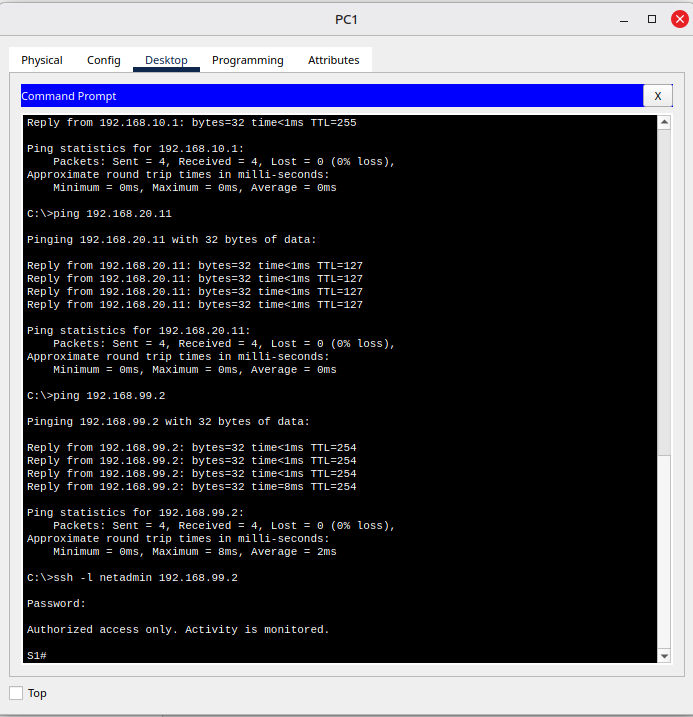 | 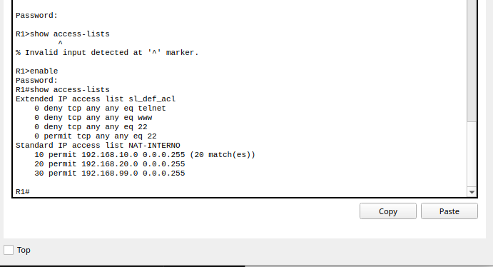 |

A partir da VLAN de usuários, o PC1:

- pingou o **AAA-Srv** (`192.168.20.11`), que só deveria conversar com os equipamentos de rede;
- pingou a **gerência do S1** (`192.168.99.2`);
- abriu **SSH no S1** e, com a senha, chegou ao prompt **`S1#`**. Entre um usuário comum e o controle total do switch, só havia a senha.

No R1, só existiam a `NAT-INTERNO` (do Lab 2) e uma ACL que ninguém criou, a `sl_def_acl` ([problema 9.5](#95-uma-acl-que-ninguém-criou-sl_def_acl)).

---

## 5. ACL 1: USUARIOS-IN

### Configuração (R1)

```text
ip access-list extended USUARIOS-IN
 remark DHCP: o pedido do PC chega como broadcast no R1
 permit udp any eq 68 any eq 67
 remark Ping ao gateway para diagnostico
 permit icmp 192.168.10.0 0.0.0.255 host 192.168.10.1 echo
 remark Web-Srv: so HTTP e HTTPS
 permit tcp 192.168.10.0 0.0.0.255 host 192.168.20.10 eq 80
 permit tcp 192.168.10.0 0.0.0.255 host 192.168.20.10 eq 443
 remark Respostas de ping para a gerencia (o Admin-PC pinga os usuarios)
 permit icmp 192.168.10.0 0.0.0.255 192.168.99.0 0.0.0.255 echo-reply
 remark Bloqueia o resto da rede interna
 deny ip 192.168.10.0 0.0.0.255 192.168.20.0 0.0.0.255
 deny ip 192.168.10.0 0.0.0.255 192.168.99.0 0.0.0.255
 remark Internet
 permit ip 192.168.10.0 0.0.0.255 any
 exit
interface g0/1.10
 ip access-group USUARIOS-IN in
```

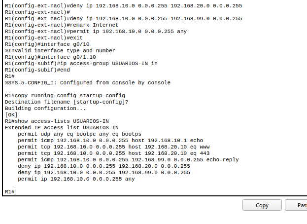

| Regra | Por que está ali |
| --- | --- |
| `permit udp any eq 68 any eq 67` | **A pegadinha do DHCP.** O PC pede IP com origem `0.0.0.0` (porta 68) para `255.255.255.255` (porta 67). Como a ACL fica na entrada da subinterface dos usuários, sem essa linha o deny implícito descartaria o pedido e os PCs ficariam sem IP |
| `echo` para `192.168.10.1` | O usuário continua conseguindo testar se a rede local funciona |
| `tcp ... eq 80` e `eq 443` para o Web-Srv | O único serviço interno de que os usuários precisam |
| `echo-reply` para a VLAN 99 | As respostas aos pings do Admin-PC. Sem ela, o administrador não conseguiria testar a conectividade dos usuários |
| `deny` para as VLANs 20 e 99 | Bloqueia o resto da rede interna |
| `permit ip 192.168.10.0 ... any` | Libera a internet. Um pacote com origem **fora** de 192.168.10.0/24 (IP falsificado) não bate em nenhuma regra e cai no deny implícito |

O IOS mostra as portas conhecidas pelo nome: 67 vira `bootps`, 68 vira `bootpc` e 80 vira `www`.

### Testes

| DHCP renovado | Ping ao gateway | Site interno |
| --- | --- | --- |
| 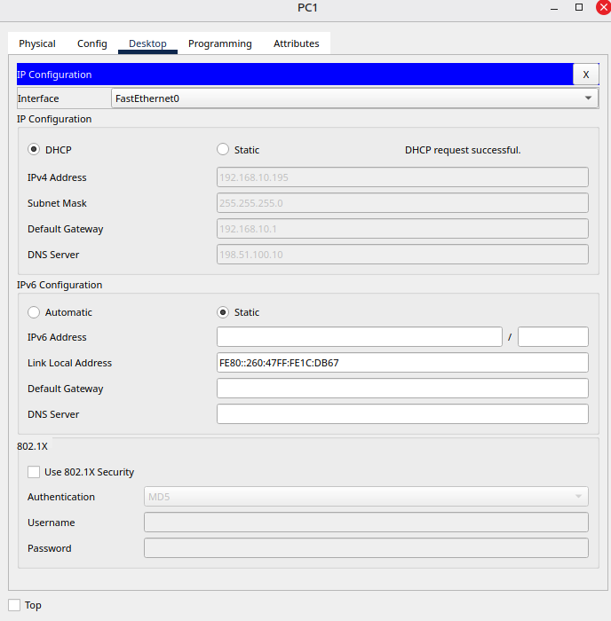 | 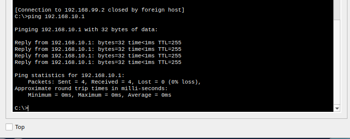 | 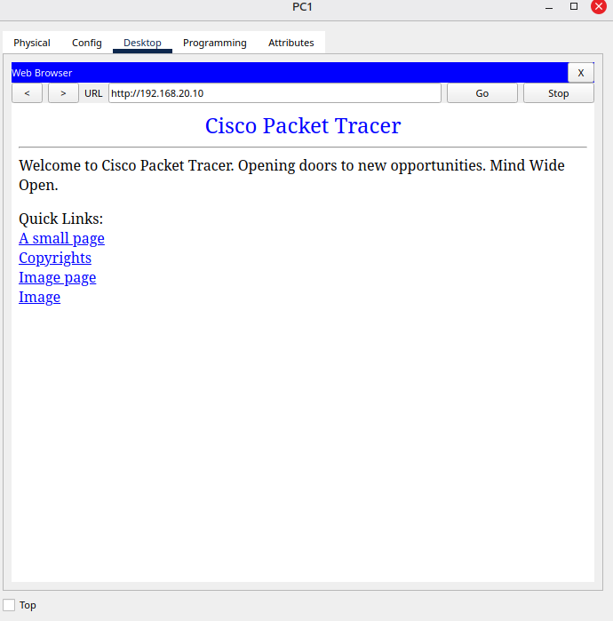 |

| Ping ao Web-Srv | Ping ao AAA-Srv | Ping à gerência |
| --- | --- | --- |
| 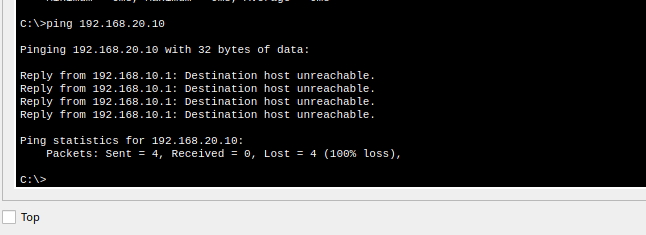 | 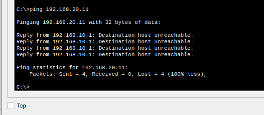 | 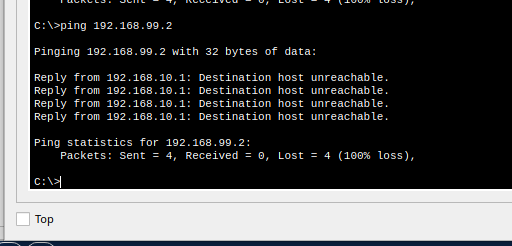 |

| SSH na gerência | Internet |
| --- | --- |
| 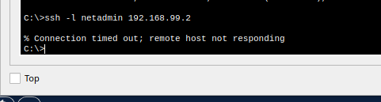 | 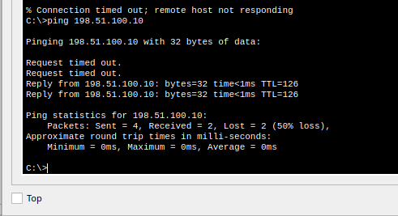 |

| # | Teste no PC1 | Resultado |
| --- | --- | --- |
| 1 | Renovar o IP por DHCP | ✅ `192.168.10.195`, gateway `.1` |
| 2 | `ping 192.168.10.1` | ✅ 4/4 |
| 3 | `http://192.168.20.10` | ✅ A página abre |
| 4 | `ping 192.168.20.10` | ❌ `Destination host unreachable` |
| 5 | `ping 192.168.20.11` | ❌ `Destination host unreachable` |
| 6 | `ping 192.168.99.2` | ❌ `Destination host unreachable` |
| 7 | `ssh -l netadmin 192.168.99.2` | ❌ `Connection timed out` |
| 8 | `ping 198.51.100.10` | ✅ TTL 126 |

O mesmo Web-Srv **aceitou o HTTP e recusou o ping**: a ACL estendida filtra por serviço, não só por endereço. Nos bloqueios, quem responde é o R1 (`Reply from 192.168.10.1: Destination host unreachable`), avisando que recusou o pacote.

### Os contadores como evidência

| Depois dos testes do PC1 | Depois do ping do Admin-PC |
| --- | --- |
| 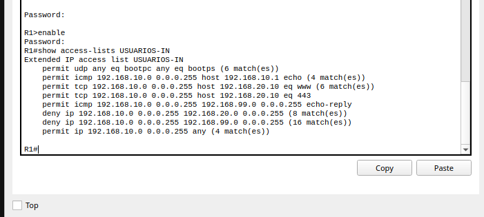 | 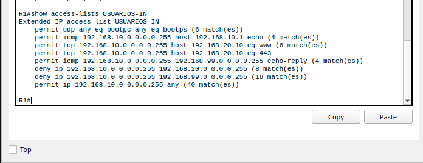 |

| Regra | Matches | De onde vêm |
| --- | --- | --- |
| DHCP | 6 | A renovação de IP do PC1 |
| echo para o gateway | 4 | Teste 2 |
| www para o Web-Srv | 6 | Os pacotes TCP do navegador |
| 443 | 0 | Ninguém usou HTTPS |
| echo-reply para a VLAN 99 | 0 → **4** | O ping do Admin-PC ao PC1 (feito depois) |
| **deny VLAN 20** | **8** | 4 pings ao Web-Srv + 4 ao AAA-Srv |
| **deny VLAN 99** | **16** | 4 pings ao S1 + as tentativas repetidas do SSH |
| permit internet | 4 → 40 | Pings e acessos à internet |

---

## 6. ACL 2: ADMIN-SSH

### O furo que a USUARIOS-IN não fecha

Com a `USUARIOS-IN` aplicada, o PC1 tentou SSH no **próprio R1**, pelo IP do gateway:

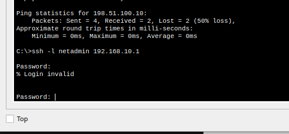

O R1 pediu a senha. O `192.168.10.1` não está nas redes 20 nem 99, então o pacote caiu no `permit` final da `USUARIOS-IN`. Filtrar por **rede de destino** não resolve: o roteador tem um IP em cada rede.

Pior: o R1 tem `login block-for 120 attempts 3 within 60` (Lab 1). Um usuário que errasse a senha três vezes colocaria o R1 em *quiet mode* e **trancaria o administrador para fora** por dois minutos.

### Configuração

**R1:**

```text
ip access-list standard ADMIN-SSH
 remark So o Admin-PC gerencia os equipamentos
 permit host 192.168.99.10
 exit
line vty 0 4
 access-class ADMIN-SSH in
```

**S1 e S2** (16 linhas VTY):

```text
ip access-list standard ADMIN-SSH
 remark So o Admin-PC gerencia os equipamentos
 permit host 192.168.99.10
 exit
line vty 0 15
 access-class ADMIN-SSH in
```

| R1 | S1 | S2 |
| --- | --- | --- |
| 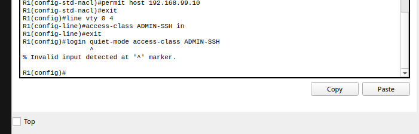 | 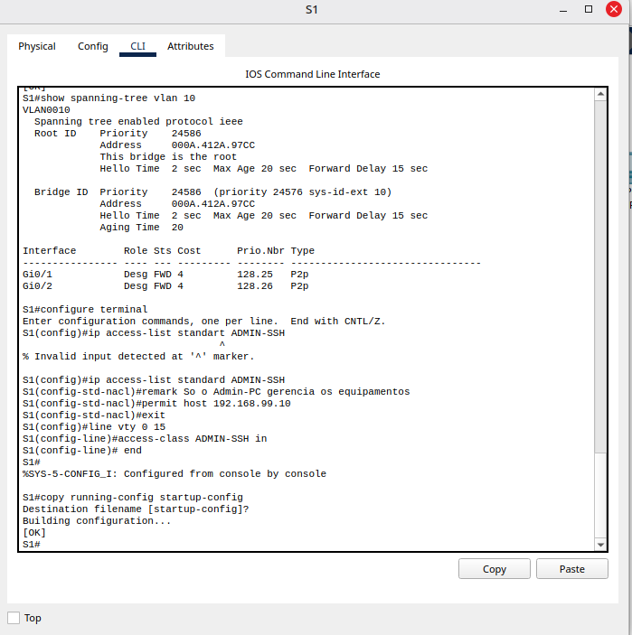 | 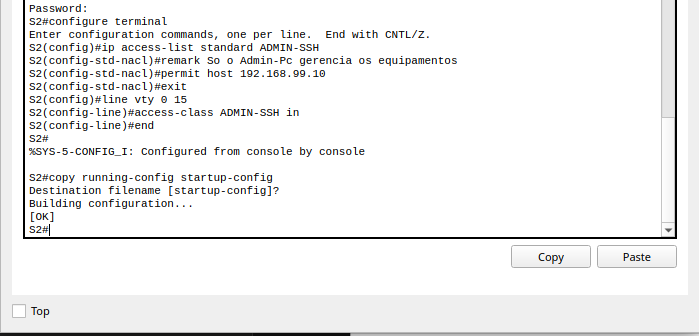 |

O `access-class` não olha a interface nem o IP de destino: qualquer tentativa de login no equipamento, chegue por onde chegar, é conferida.

### Testes

| PC1 → SSH no R1 | ISP → SSH no R1 | Admin-PC → R1, S1, S2 e ping ao PC1 |
| --- | --- | --- |
| 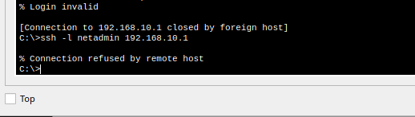 | 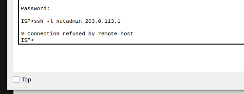 | 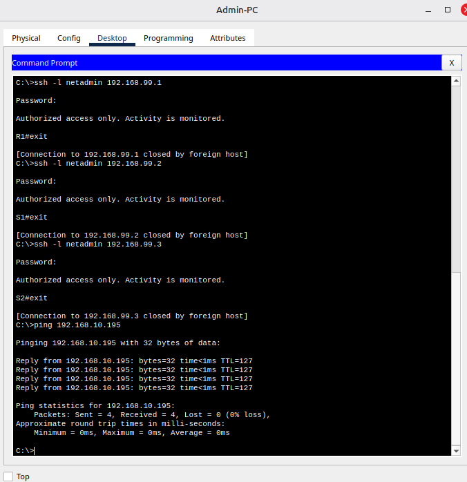 |

| Origem | Comando | Resultado |
| --- | --- | --- |
| PC1 | `ssh -l netadmin 192.168.10.1` | ❌ **`Connection refused by remote host`**, sem nem pedir senha |
| ISP | `ssh -l netadmin 203.0.113.1` | ❌ **`Connection refused`** (no Lab 1, esse SSH entrava no R1) |
| Admin-PC | SSH para `192.168.99.1`, `.2` e `.3` | ✅ Entrou nos três |
| Admin-PC | `ping 192.168.10.195` | ✅ 4/4 (regra `echo-reply` da USUARIOS-IN) |

Como a conexão é recusada **antes do pedido de senha**, um usuário não consegue mais errar a senha três vezes. O risco de trancar o administrador para fora foi resolvido pela mesma ACL.

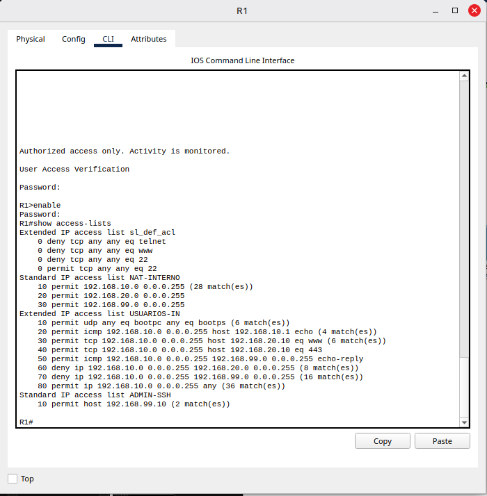

A `ADMIN-SSH` mostra `permit host 192.168.99.10 (2 match(es))`. As recusas do PC1 e do ISP **não aparecem em nenhum contador**: elas caíram no deny implícito, que não tem linha nem contador ([problema 9.8](#98-o-deny-implícito-não-tem-contador)).

---

## 7. ACL 3: ANTI-SPOOF

### Antes: a internet fingindo ser um IP privado

No ISP, foi criada uma loopback com um IP privado, que **nunca** deveria aparecer como origem vindo da internet, e o R1 foi pingado a partir dela com o ping estendido:

```text
interface loopback0
 ip address 10.10.10.1 255.255.255.255
```

O resultado foi `!!!!!` (5/5): o R1 aceitou o pacote e ainda respondeu, porque a resposta seguiu pela rota padrão até o ISP.

### Configuração (R1)

```text
ip access-list extended ANTI-SPOOF
 remark Origens que nunca deveriam chegar pela internet
 deny ip 0.0.0.0 0.255.255.255 any
 deny ip 10.0.0.0 0.255.255.255 any
 deny ip 172.16.0.0 0.15.255.255 any
 deny ip 192.168.0.0 0.0.255.255 any
 deny ip 127.0.0.0 0.255.255.255 any
 deny ip 224.0.0.0 15.255.255.255 any
 permit ip any any
 exit
interface g0/0
 ip access-group ANTI-SPOOF in
```

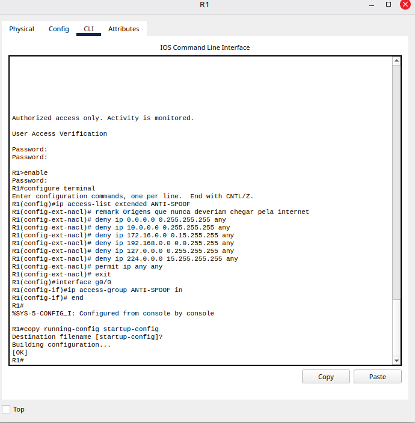

| Faixa bloqueada como origem | Por quê |
| --- | --- |
| `0.0.0.0/8` | "Esta rede": inválida como origem |
| `10.0.0.0/8`, `172.16.0.0/12`, `192.168.0.0/16` | Privadas (RFC 1918): não existem na internet. A `192.168.0.0/16` também barra alguém de fora **fingindo ser da rede interna** |
| `127.0.0.0/8` | Loopback: só existe dentro do próprio equipamento |
| `224.0.0.0/4` | Multicast: nunca é origem de um pacote |

### Antes e depois

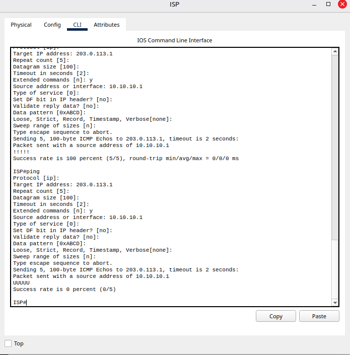

| | Ping do ISP com origem `10.10.10.1` |
| --- | --- |
| Antes | `!!!!!`, 100% |
| Depois | `UUUUU`, 0% |

O `U` (*unreachable*) é diferente do `.` (timeout): é o R1 avisando ativamente que recusou o pacote.

| Contadores | PC1 depois de todas as ACLs |
| --- | --- |
| 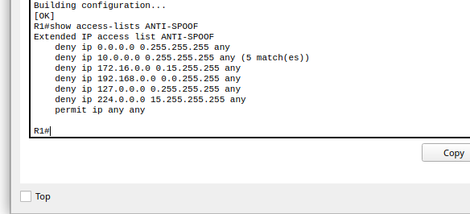 | 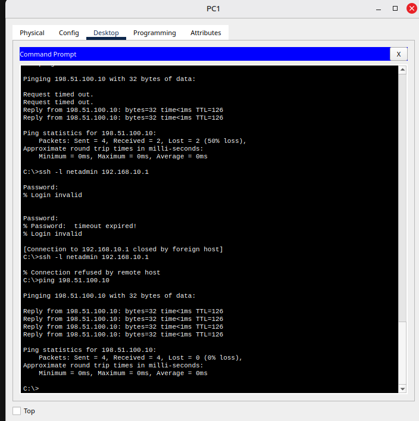 |

- `deny ip 10.0.0.0 0.255.255.255 any (5 match(es))`: exatamente os 5 pings falsificados.
- O PC1 continua navegando (`ping 198.51.100.10`, 4/4): as respostas da internet vêm de um IP público e passam pelo `permit ip any any`. O print dos contadores foi tirado antes desse ping, por isso o `permit` ainda aparece sem contador.

---

## 8. Visão final das ACLs

| ACL | Equipamento | Aplicada em | Regras |
| --- | --- | --- | --- |
| `USUARIOS-IN` | R1 | G0/1.10 `in` | 8 (5 permit específicos, 2 deny, 1 permit geral) |
| `ADMIN-SSH` | R1, S1, S2 | `line vty` com `access-class in` | 1 permit + deny implícito |
| `ANTI-SPOOF` | R1 | G0/0 `in` | 6 deny + 1 permit geral |
| `NAT-INTERNO` | R1 | NAT (Lab 2) | Não filtra tráfego: só seleciona quem é traduzido |
| `sl_def_acl` | R1 | Criada pelo `login block-for` | Usada só durante o quiet mode |

**Regra dos "3 Ps":** no máximo uma ACL por **p**rotocolo, por **p**orta (interface) e por direção. As ACLs deste lab ficam em interfaces e direções diferentes, então não competem entre si.

---

## 9. Problemas encontrados e soluções

### 9.1 `log` não é suportado no Packet Tracer

**Sintoma:** `% Invalid input detected at '^' marker` no fim de `deny ip 192.168.10.0 0.0.0.255 192.168.20.0 0.0.0.255 log`.
**Causa:** o Packet Tracer não aceita a palavra-chave `log` nas ACLs. No IOS real, ela gera uma mensagem de log a cada pacote bloqueado.
**Solução:** retirar o `log` e usar os contadores (`match(es)`) do `show access-lists` como evidência.

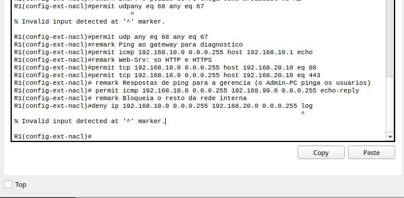

### 9.2 `login quiet-mode access-class` não existe no Packet Tracer

**Sintoma:** `% Invalid input` no comando que deixaria o Admin-PC entrar durante o quiet mode.
**Contorno:** o próprio `access-class` resolveu o risco. Como o login é recusado antes do pedido de senha para qualquer origem que não seja o Admin-PC, ninguém mais consegue errar a senha três vezes. No IOS real, vale configurar os dois.

### 9.3 `show access-lists` no modo errado

**Sintoma:** `% Invalid input` em `R1>show access-lists`.
**Causa:** o prompt era `R1>` (modo usuário). O comando só existe no modo privilegiado.
**Solução:** `enable` antes.

### 9.4 `ping ... source` não existe no Packet Tracer

**Sintoma:** `% Invalid input` em `ping 203.0.113.1 source loopback0`.
**Solução:** usar o **ping estendido**: digitar só `ping` e, em `Extended commands`, responder `y` e informar `10.10.10.1` como origem.

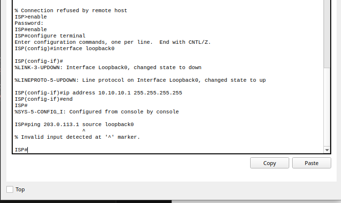

### 9.5 Uma ACL que ninguém criou: `sl_def_acl`

**Sintoma:** o primeiro `show access-lists` mostrou uma ACL `sl_def_acl` com regras de telnet, www e porta 22.
**Causa:** ela é criada automaticamente pelo `login block-for` (Lab 1) e aplicada nas linhas VTY durante o quiet mode. Os contadores em 0 mostram que o quiet mode nunca foi ativado.
**Lição:** ao auditar um equipamento, nem toda ACL foi escrita por alguém. Algumas vêm de outros recursos.

### 9.6 Erros de digitação

| Erro | Efeito |
| --- | --- |
| `ip access-list standart` (com **t**) | `% Invalid input`. Como a ACL não foi criada, o `remark` seguinte também falhou: o prompt continuou em `R1(config)#` em vez de `R1(config-std-nacl)#` |
| `interface g0/10` | `%Invalid interface type and number` (o certo era `g0/1.10`) |
| `permit udpany` | `% Invalid input` |

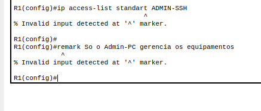

**Lição:** depois de criar uma ACL, conferir se o prompt mudou para `config-std-nacl` (padrão) ou `config-ext-nacl` (estendida) antes de colar as regras.

### 9.7 Numeração das regras inconsistente

No primeiro `show access-lists USUARIOS-IN`, as regras apareceram **sem** os números de sequência; num `show access-lists` posterior, elas apareceram numeradas de 10 a 80. É um comportamento do Packet Tracer. A ordem de avaliação é a mesma nos dois casos.

### 9.8 O deny implícito não tem contador

As recusas da `ADMIN-SSH` (PC1 e ISP) não apareceram em nenhuma linha. Elas caíram no **deny implícito**, que não tem contador. Para contar as tentativas bloqueadas, seria preciso terminar a ACL com um `deny any` explícito.

---

## 10. Limitações e riscos em aberto

| Limitação | Por quê | Onde será tratado |
| --- | --- | --- |
| **ACLs não guardam estado** | Foi preciso abrir `echo-reply` "na mão" para o Admin-PC conseguir pingar os usuários. Para cada novo serviço iniciado da gerência, seria preciso abrir outra exceção na volta | Lab 6 (Zone-Based Firewall, *stateful*) |
| **A VLAN de servidores não tem filtro** | Um servidor comprometido ainda alcança a gerência e os usuários | Extensão futura: ACL na entrada da G0/1.20 |
| **A identidade do administrador é um IP** | Quem conseguir usar o IP `192.168.99.10` (por exemplo, pluga na porta do Admin-PC com outro equipamento) passa pela `ADMIN-SSH`. O port security do Lab 3 dificulta, mas um MAC clonado contorna | Lab 5 (AAA com servidor central, e 802.1X) |
| **Sem log das tentativas bloqueadas** | O Packet Tracer não aceita `log`, e o deny implícito não conta | Lab 5 (Syslog) |
| **Tráfego dentro da mesma VLAN não passa pelo R1** | PC1 ↔ PC2 conversam direto pelo switch, sem ACL | Fora do escopo (seriam *private VLANs* ou VACLs) |
| **HTTPS não foi testado** | A regra `443` está em 0 matches: o Web-Srv do Packet Tracer só foi acessado por HTTP | - |
| **O anti-spoofing não cobre o bloco do próprio enlace** | `203.0.113.0/30` é compartilhado com o ISP, então não pode ser negado como origem | Decisão de projeto |

---

## 11. Lições aprendidas

- **Escrever a política antes das regras.** A tabela da seção 2 virou, quase linha por linha, as ACLs.
- **A ordem é tudo:** exceções específicas primeiro, `deny` depois, `permit` geral por último.
- **ACL na entrada da VLAN de usuários precisa liberar o DHCP**, porque o pedido sai de `0.0.0.0` para broadcast.
- **Filtrar por rede de destino não protege o próprio roteador:** ele tem um IP em cada rede. Login se protege com `access-class` nas linhas VTY.
- **Uma ACL pode resolver o efeito colateral de outra proteção:** o `access-class` impediu que o `login block-for` virasse uma forma de trancar o administrador para fora.
- **ACLs não guardam estado:** cada resposta precisa ser permitida explicitamente, o que mostra o limite da ferramenta e o motivo dos firewalls *stateful*.
- **Os contadores são a evidência:** cada teste bloqueado ou permitido apareceu como `match(es)` na regra certa.
- **`U` não é `.`:** *unreachable* é o roteador avisando que recusou; timeout é o pacote se perdendo.

---

## 12. Próximo passo

**Lab 5: AAA, Syslog e NTP.** Trocar as senhas locais de cada equipamento por autenticação central no AAA-Srv, enviar os logs de R1, S1 e S2 para um servidor Syslog e sincronizar o relógio de todos com NTP, para que os registros de cada tentativa bloqueada tenham data e hora confiáveis.
